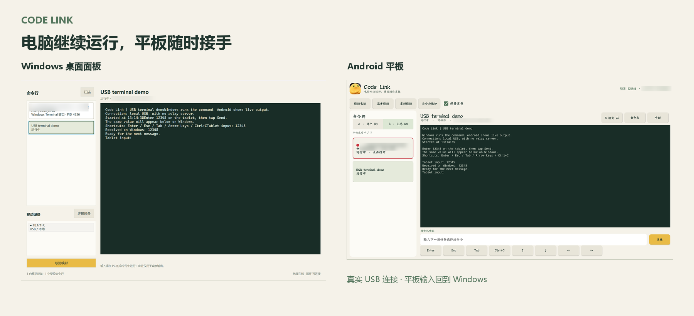
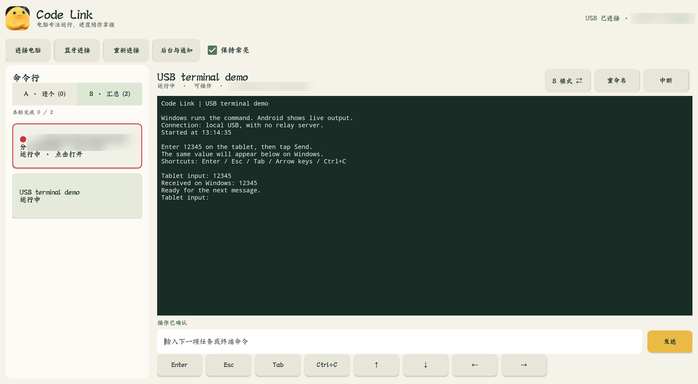
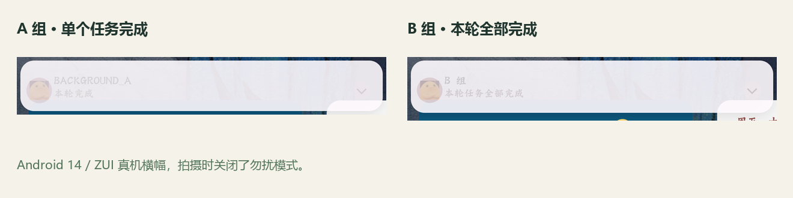

<p align="center"></p>
<h1 align="center">Code Link</h1>
<p align="center"><strong>Keep tasks running on Windows. Follow progress and respond from Android.</strong></p>
<p align="center">
<a href="https://github.com/ZARADEE/code_LINK/releases/latest"></a>
<a href="https://github.com/ZARADEE/code_LINK/actions/workflows/ci.yml"></a>
<a href="LICENSE"></a>
</p>
<p align="center"><a href="https://github.com/ZARADEE/code_LINK/releases/latest">Download</a> · <a href="README.md">简体中文</a> · <a href="https://zaradee.github.io/code_LINK/en.html">Website</a> · <a href="docs/ROADMAP.md">Roadmap</a></p>



Code Link is a local terminal companion for Windows and Android. View terminal output, send text and keys, answer approval prompts, and receive completion notifications while your terminal is minimized or covered by other windows.

The desktop app is a lightweight **WPF tray application**. The Android app uses native Java controls and xterm.js for managed terminal rendering. Connections use USB or Bluetooth without an account or relay server.

## Get started

1. Download `CodeLink-Windows-v1.2.0.zip` and `CodeLink-Android.apk` from [Releases](https://github.com/ZARADEE/code_LINK/releases/latest).
2. On Windows, install the [.NET 10 Desktop Runtime, x64](https://dotnet.microsoft.com/en-us/download/dotnet/10.0), extract the entire ZIP, and open `CodeLink.exe`.
3. Install the APK on your Android device. Enable **Developer options → USB debugging**, connect a data-capable USB cable, unlock the tablet, and accept the computer's debugging authorization. File transfer is a suitable USB mode.
4. Open Code Link on both devices. On the PC, choose **连接设备 → USB 一键连接** (Connect device → USB quick connect).
5. Select a terminal and the connected tablet, then click **映射到移动端** (Map to mobile). You can also open a detected terminal from the tablet's list.

The app currently uses a Chinese interface. Android 9 or later is required; landscape tablets are the primary layout. Hardware validation used a Lenovo Xiaoxin Pad Pro 12.7, Android 14 / ZUI 16.

Each release includes `SHA256SUMS.txt`. See the [installation guide](docs/INSTALL.md) for verification. The Android APK uses a development signing key; Windows executables are unsigned.

## Your terminal, within reach



- Monitor detected PowerShell, Command Prompt, Windows Terminal, and Codex windows.
- Send text, Enter, Esc, Tab, arrow keys, or Ctrl+C from the tablet.
- Respond to terminal prompts, or use structured Codex approval cards through `clink codex`.
- Rename terminals on the tablet and organize them into A/B tabs.
- Keep receiving updates in the background, with system completion banners.

Existing Windows Terminal mappings follow the **active tab of that window**. Use separate windows to monitor several tabs independently. Higher-privilege terminals, ambiguous window titles, or unsupported console interfaces can prevent input; the app shows the reason.

External windows synchronize readable text and spacing. Full colors and graphical cursor effects are not reproduced. Output caching is limited to approximately 120,000 characters.

## A/B completion reminders

| Group | When it alerts | How it clears |
| --- | --- | --- |
| A | Each task completes individually | Read that terminal's reminder |
| B, the default | Every task that actually ran in the current round completes successfully | Read all completed members, or acknowledge the batch |

Idle terminals that never started do not block a B round. Failed, disconnected, unknown, or interrupted tasks do not count as successful completion. Approval and question prompts alert immediately in either group. Acknowledging a reminder does **not** approve a command.



Completion detection depends on the terminal source. Managed finite commands use process exit status; `clink codex` uses structured turn events. Existing terminal windows use supported screen markers. Unrecognized output remains unknown and does not produce a success notification.

## Background connection

Open **后台与通知** (Background and notifications) and allow notifications, completion banners, and background operation. The connected-device foreground service keeps a quiet ongoing connection notification. Android's notification settings and Do Not Disturb determine whether a banner appears.

Keep the Windows tray app running. Force-stopping the Android app, stopping its foreground service, unplugging the cable, or sleeping the PC affects live updates. Reconnection restores current state without automatically replaying unacknowledged input.

USB background delivery, A/B banners, screen-off notifications, and content restoration were tested on the tablet, including one **89-minute continuous USB connection**. Bluetooth input and reconnection were also tested; Bluetooth screen-off behavior and LAN device-to-device operation still need further validation.

## Connection options

| Transport | Setup | Current validation |
| --- | --- | --- |
| USB | USB debugging and computer authorization; ADB reverse + TLS | Recommended first connection; tested on hardware |
| Bluetooth | Pair in system settings, establish app trust over USB, then choose Bluetooth in the app | RFCOMM input and reconnection tested; PAN is not required |
| Local network | Enable LAN access, pair using connection details or QR; TCP connectivity required | Implemented; hardware acceptance pending |

Code Link's connection stays local. A task running inside the terminal may still use its own internet connection.

## Launch managed terminals

From the extracted Windows directory:

```powershell
.\clink.exe terminal --cwd "D:\project" --name "Project terminal" --new-window
.\clink.exe codex --cwd "D:\project" --name "Project assistant" --new-window
.\clink.exe scan
```

The `codex` command requires a locally installed Codex CLI. `terminal` defaults to PowerShell and accepts a program after `--`. These commands open real terminal windows. See the [implementation guide (Chinese)](docs/implementation.zh-CN.md) for details.

## Help and development

- [Report a problem](https://github.com/ZARADEE/code_LINK/issues/new/choose) with your OS, app version, transport, terminal type, and reproduction steps.
- [Build from source](docs/BUILDING.md) · [Contribute](CONTRIBUTING.md) · [Community guidelines](CODE_OF_CONDUCT.md) · [Security](SECURITY.md) · [Changelog](CHANGELOG.md)
- [Chinese usage guide and troubleshooting](README.md) · [Validation record](research/pad-background-acceptance.json)

Windows and Android are the current targets. iPad/iOS, macOS/Linux desktop, and WSL are not validated targets.

Code is licensed under [MIT](LICENSE). Supplied artwork has [separate terms](assets/README.md); dependencies retain their [original licenses](THIRD_PARTY_NOTICES.md). Maintained by [ZARADEE](https://github.com/ZARADEE), independently of terminal and AI vendors.

Windows and Android screenshots were captured on connected devices on November 14, 2026; notification banners come from earlier hardware validation. Local paths, computer names and private window titles are blurred. [Image provenance](docs/assets/README.md). Documentation corresponds to Android 1.2.0.
