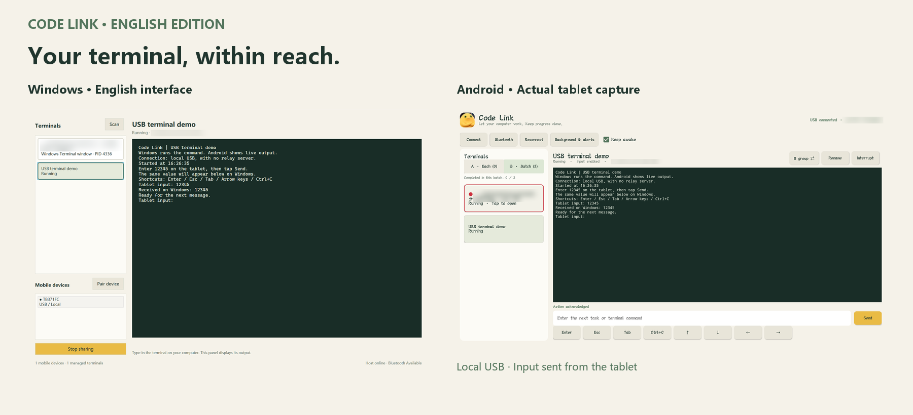
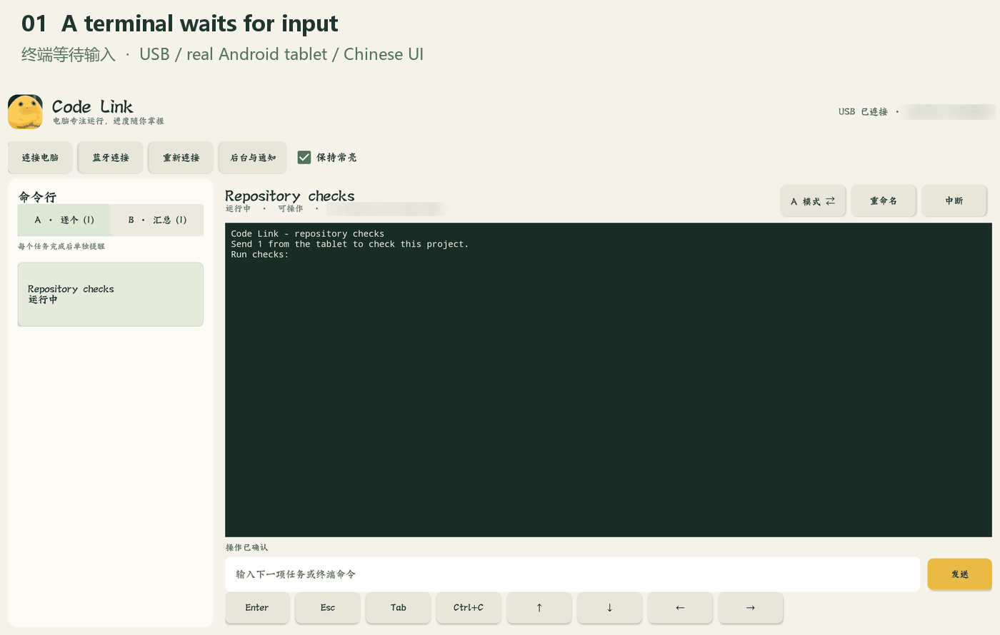
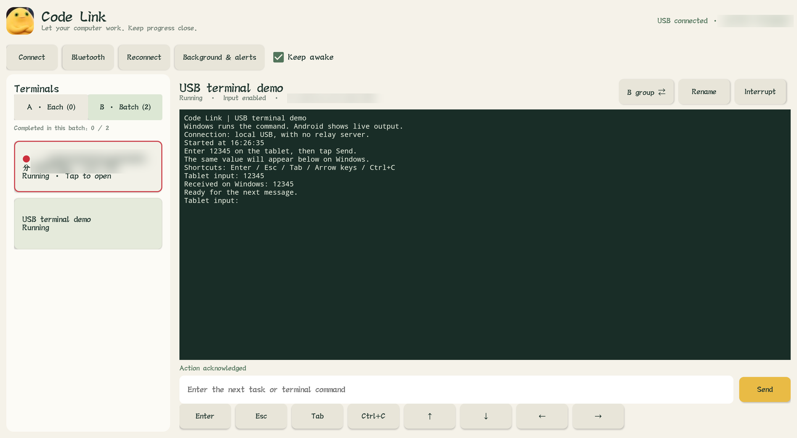
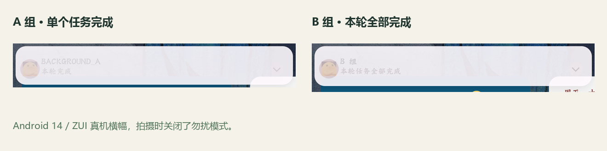
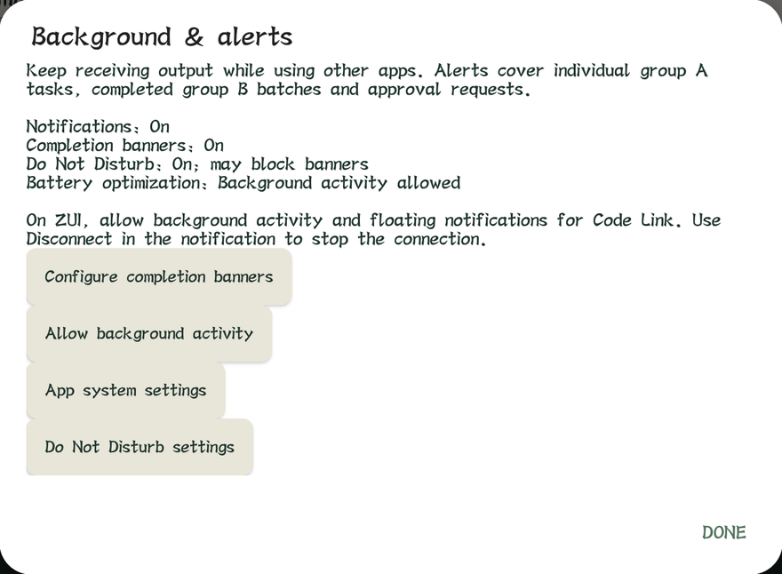
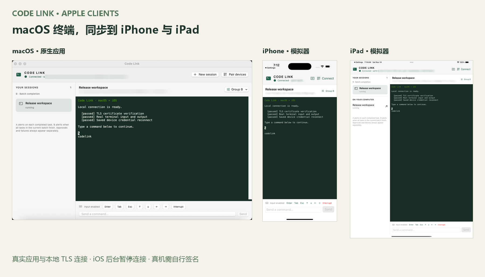

<p align="center"></p>
<h1 align="center">Code Link</h1>
<p align="center"><strong>Turn your Android tablet into a dashboard for Windows terminal tasks.</strong></p>
<p align="center">Local connection · Terminal input · Codex approvals · Individual and batch alerts</p>
<p align="center"><strong>English</strong> · <a href="README.zh-CN.md">简体中文</a></p>
<p align="center">
<a href="https://github.com/ZARADEE/code_LINK/releases/latest"></a>
<a href="https://github.com/ZARADEE/code_LINK/actions/workflows/ci.yml"></a>
<a href="LICENSE"></a>
</p>
<p align="center"><a href="#get-started">Get started</a> · <a href="#choose-your-devices">Downloads</a> · <a href="#macos-and-ios">Mac &amp; iOS</a> · <a href="https://github.com/ZARADEE/code_LINK/discussions">Ask a question</a> · <a href="https://zaradee.github.io/code_LINK/en.html">Website</a></p>



Keep your build, tests or Codex task running on the PC. Use the tablet beside you to read output, send a command, respond to an approval, and get an alert when a task or a whole batch finishes. Connect directly over USB or Bluetooth, with no account or relay server.

## Who is this for?

You develop on Windows, keep Codex, builds or tests running in several terminals, and have an Android tablet beside your desk. Code Link gives those tasks a separate screen so you can keep working without repeatedly bringing terminal windows to the front.

- **Codex needs an answer while you work elsewhere.** Read the prompt on the tablet and respond there. Connect an existing Codex window for terminal input; start with `clink codex` when you want structured approval cards and turn events.
- **Several independent jobs need watching.** Give each terminal a name. Use A for individual completion reminders, or B for a reminder after every participating job in that round succeeds. Failed or interrupted work stays visible instead of being counted as done.
- **A spare tablet can stay on the desk.** Connect it by USB, put the terminal dashboard beside your editor, then switch Android apps while the foreground service handles supported alerts. No account, cloud relay or extra monitor is needed.

The strongest supported setup is **Windows + an Android tablet on the same desk**. It combines existing-window capture, local USB/Bluetooth, terminal input and batch reminders. A regular second monitor is useful for full graphical windows; SSH is useful for remote server administration. Choose Code Link when you want this local terminal workflow on a device you already own. Mac creates managed sessions over LAN; iOS is a developer preview, as detailed below.

**[Follow three complete workflows: Codex, parallel jobs and a spare tablet →](https://zaradee.github.io/code_LINK/windows-android-terminal.en.html)**

## Why use Code Link?

| While the computer works… | On your tablet |
| --- | --- |
| A terminal is minimized or covered | Read its current output and send text or shortcut keys |
| Several tasks run in parallel | Name them, group them, and follow individual or batch completion |
| Codex needs your decision | Answer the original terminal prompt, or use structured cards with `clink codex` |
| You switch to another Android app | Receive completion and attention notifications through the background service |

Existing Windows terminal windows can be connected directly. Managed terminals use a PTY; `clink codex` adds structured turn and approval events. [How task completion is detected](#ab-completion-reminders).



**See the complete loop.** A command sent from the tablet starts this repository's documentation and English translation checks; the output returns to Android and A mode marks the task complete. These are four real captures from the Chinese app over USB, with shortened display timing. [Still image](docs/assets/workflow-complete.png).

## Choose your devices

| Your setup | Current experience | Download / setup |
| --- | --- | --- |
| **Windows + Android tablet** | Existing terminal capture, input, USB/Bluetooth and Android background alerts; tested on hardware | **[Windows English ZIP](https://github.com/ZARADEE/code_LINK/releases/download/v1.4.1/CodeLink-Windows-v1.4.1-en.zip)** + **[Android English APK](https://github.com/ZARADEE/code_LINK/releases/download/v1.4.1/CodeLink-Android-v1.4.1-en.apk)** |
| **Mac + Android** | Create managed terminal/Codex sessions on Mac; connect over LAN. Physical cross-device acceptance is pending | [Apple silicon ZIP](https://github.com/ZARADEE/code_LINK/releases/download/v1.4.1/CodeLink-macOS-AppleSilicon-v1.4.1-en.zip) / [Intel ZIP](https://github.com/ZARADEE/code_LINK/releases/download/v1.4.1/CodeLink-macOS-Intel-v1.4.1-en.zip) · [Mac guide](docs/APPLE.md) |
| **iPhone / iPad** | Developer preview: simulator or personal device signing; connection pauses in the background | [Apple guide and source](docs/APPLE.md) |

Windows x64 packages include the .NET 10 Desktop Runtime; extract the whole ZIP and launch `CodeLink.exe`. Android requires version 9+. Narrow phone windows show a terminal list and a separate detail screen; tablets show both panes when space permits. Rotation preserves each terminal’s unsent draft. Mac packages include the runtime and require macOS 14+. Mac apps are ad-hoc signed and not notarized. **Using the Mac app does not require iPhone signing.**

For Simplified Chinese, download [Windows zh-CN](https://github.com/ZARADEE/code_LINK/releases/download/v1.4.1/CodeLink-Windows-v1.4.1-zh-CN.zip) and [Android zh-CN](https://github.com/ZARADEE/code_LINK/releases/download/v1.4.1/CodeLink-Android-v1.4.1-zh-CN.apk). Filename suffixes `-en` and `-zh-CN` identify the interface language. Install either Android edition over the other to keep pairing and settings. [Verify downloads and upgrade](docs/INSTALL.en.md).

## Get started

Windows + Android supports **USB and Bluetooth**. The steps below use USB; Bluetooth setup is described under [Connection options](#connection-options). Keep both applications open during setup.

| Step | What to do | You should see |
| --- | --- | --- |
| 1. Install | Extract the entire Windows ZIP and open `CodeLink.exe`. Install the Android APK | The desktop terminal list and the tablet's **Connect** button |
| 2. Authorize the cable | Enable **Developer options → USB debugging** on Android. Connect a data cable, unlock the tablet and approve the computer | The tablet accepts the USB debugging authorization |
| 3. Pair | In Windows, choose **Pair device → Connect over USB** in the guided connection window | **USB connected** in the Windows wizard after Android confirms the connection |
| 4. Open a terminal | Select a terminal on the tablet, or select a terminal and device in Windows and choose **Share with device** | The same terminal output on both screens |
| 5. Try one input | Use a test terminal, send `echo hello`, and press **Enter** if needed | `hello` appears in that terminal |
| 6. Enable alerts | On Android, open **More → Background & alerts**, allow banners and background activity, then run a task with a supported completion signal | A completion or attention reminder when applicable |

If a step stalls, use the [connection checklist on the website](https://zaradee.github.io/code_LINK/en.html#start) or the troubleshooting below. Hardware validation used a Lenovo Xiaoxin Pad Pro 12.7, Android 14 / ZUI 16. [Acceptance records](research/english-release-acceptance.json).

## Your terminal, within reach



- Monitor detected PowerShell, Command Prompt, Windows Terminal, and Codex windows.
- Send text, Enter, Esc, Tab, arrow keys, or Ctrl+C from the tablet.
- Respond to terminal prompts, or use structured Codex approval cards through `clink codex`.
- Rename terminals on the tablet and organize them into A/B tabs.
- Keep receiving updates in the background, with system completion banners.

Existing Windows Terminal mappings follow the **active tab of that window**. Use separate windows to monitor several tabs independently. Higher-privilege terminals, ambiguous window titles, or unsupported console interfaces can prevent input; the app shows the reason.

External windows synchronize readable text and spacing. Full colors and graphical cursor effects are not reproduced. Output caching is limited to approximately 120,000 characters.

## A/B completion reminders

| Group | When it alerts | How it clears |
| --- | --- | --- |
| A | Each task completes individually | Read that terminal's reminder |
| B, the default | Every task that actually ran in the current round completes successfully | Read all completed members, or acknowledge the batch |

Idle terminals that never started do not block a B round. Failed, disconnected, unknown, or interrupted tasks do not count as successful completion. Approval and question prompts alert immediately in either group. Acknowledging a reminder does **not** approve a command.



Completion detection depends on the terminal source. Managed finite commands use process exit status; `clink codex` uses structured turn events. Existing terminal windows use supported screen markers. Unrecognized output remains unknown and does not produce a success notification.

## Background connection

Open **More → Background & alerts** and allow notifications, completion banners, and background operation. The connected-device foreground service keeps a quiet ongoing connection notification. Android's notification settings and Do Not Disturb determine whether a banner appears.



Keep the Windows tray app running. Force-stopping the Android app, stopping its foreground service, unplugging the cable, or sleeping the PC affects live updates. Reconnection restores current state without automatically replaying unacknowledged input.

USB background delivery, A/B banners, screen-off notifications, and content restoration were tested on the tablet, including one **89-minute continuous USB connection**. Bluetooth input and reconnection were also tested; Bluetooth screen-off behavior and LAN device-to-device operation still need further validation.

## Connection options

| Transport | Setup | Current validation |
| --- | --- | --- |
| USB | USB debugging and computer authorization; ADB reverse + TLS | Recommended first connection; tested on hardware |
| Bluetooth | System pairing plus Code Link app trust; no prior USB connection required | RFCOMM input and reconnection tested; PAN is not required |
| Local network | Enable LAN access, pair using connection details or QR; TCP connectivity required | Implemented; hardware acceptance pending |

Code Link's connection stays local. A task running inside the terminal may still use its own internet connection.

For Bluetooth, pair the devices in system settings. Existing Code Link pairing can be reused through **More → Bluetooth** on Android. For first-time app pairing, choose **Pair device → Bluetooth** in Windows and **Connect → Bluetooth** on Android, scan or paste the invitation, allow Nearby devices, then select the paired PC. Neither USB nor Wi-Fi is required. [Bluetooth setup and troubleshooting](docs/INSTALL.en.md#bluetooth).

## Launch managed terminals

From the extracted Windows directory:

```powershell
.\clink.exe terminal --cwd "D:\project" --name "Project terminal" --new-window
.\clink.exe codex --cwd "D:\project" --name "Project assistant" --new-window
.\clink.exe scan
```

The `codex` command requires a locally installed Codex CLI. `terminal` defaults to PowerShell and accepts a program after `--`. These commands open real terminal windows. See the [implementation guide (Chinese)](docs/implementation.zh-CN.md) for details.

## macOS and iOS



The Mac app creates managed zsh terminals and local Codex sessions. Connect an Android device, iPhone or iPad over LAN. The Mac host and production Swift client passed TLS, PTY, credential and simulator integration checks. Mac currently shares sessions created in Code Link; existing Terminal/iTerm window capture is a Windows-only capability.

Download the Mac ZIP for your processor, extract `CodeLink.app` and move it to Applications. If macOS blocks its first launch, follow the [Mac opening instructions](docs/APPLE.md). iPhone signing is needed only when installing the separate iOS client on a physical iPhone or iPad.

iOS 17+ is a developer preview with a simulator app, unsigned device archive and Xcode source project. It pauses the connection in the background and reconnects on return. There is no signed IPA or TestFlight distribution. [Apple installation and capability matrix](docs/APPLE.md).

## Troubleshooting your first connection

| What you see | Next step |
| --- | --- |
| Windows asks for .NET | Use the complete v1.4.1 ZIP, which includes the runtime. Do not copy out only the EXE. Older packages need .NET 10 Desktop Runtime x64 |
| Tablet absent or unauthorized | Unlock it, check USB debugging and the computer authorization, and try a data-capable cable. Run `tools\adb.exe -P 5037 devices -l` and repeat on port `5038` if needed |
| Connected, but no output | Choose a terminal on Android, or select both a terminal and an online device in Windows and share it |
| Input rejected | Check input control, terminal permissions and unique window titles. Existing Windows Terminal mappings follow the active tab |
| No completion banner | Check the task's detected status, then **More → Background & alerts**, system banners and Do Not Disturb. An interactive shell stays running between commands |
| Mac asks about an unidentified developer | Follow **System Settings → Privacy & Security → Open Anyway** after checking the source and checksum; see the Mac guide |

## Help and development

For a plain-language walkthrough of the stack, message flow, core modules and extension points, read [if_want_learn.md (Chinese)](if_want_learn.md).

- [Report a problem](https://github.com/ZARADEE/code_LINK/issues/new/choose) with your OS, app version, transport, terminal type, and reproduction steps.
- [Build from source](docs/BUILDING.md) · [Contribute](CONTRIBUTING.md) · [Community guidelines](CODE_OF_CONDUCT.md) · [Security](SECURITY.md) · [Changelog](CHANGELOG.md)
- [Chinese usage guide and troubleshooting](README.zh-CN.md) · [Validation record](research/pad-background-acceptance.json)

Windows / Android and native macOS 14+ / iOS 17+ clients are available. Apple clients use LAN and managed terminals; iOS pauses in the background and currently requires a simulator or personal signing. Linux and WSL remain unvalidated.

Code is licensed under [MIT](LICENSE). Supplied artwork has [separate terms](assets/README.md); dependencies retain their [original licenses](THIRD_PARTY_NOTICES.md). Maintained by [ZARADEE](https://github.com/ZARADEE), independently of terminal and AI vendors.

English Windows and Android screenshots were captured on connected devices on November 14, 2026; the Chinese notification banners come from earlier hardware validation. Local paths, computer names and private window titles are blurred. [Image provenance](docs/assets/README.md) · [English UI acceptance record](research/english-release-acceptance.json). Documentation corresponds to v1.4.1; the existing tablet screenshots show the v1.3.0 interface, which is unchanged on Android.
