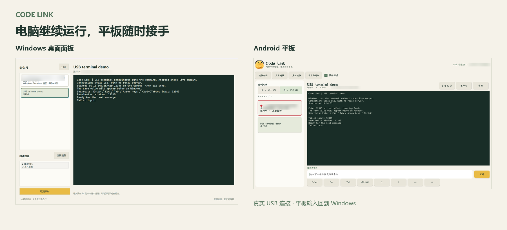
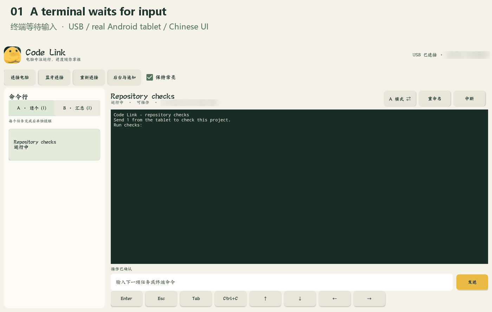
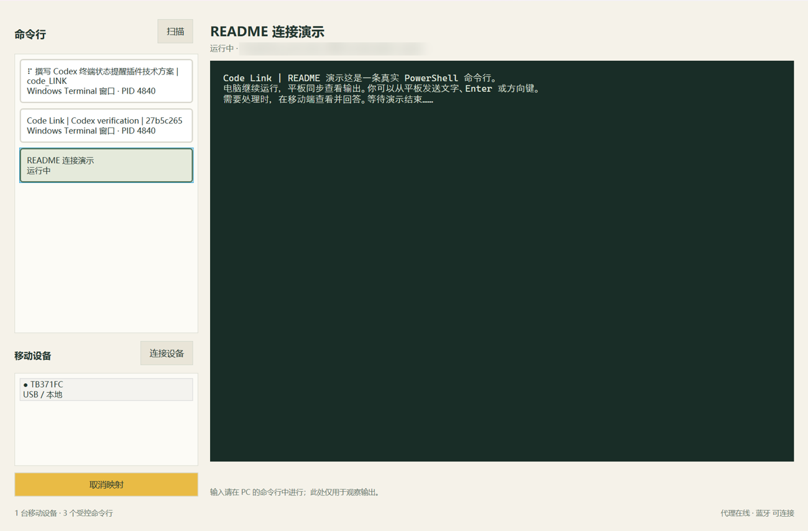
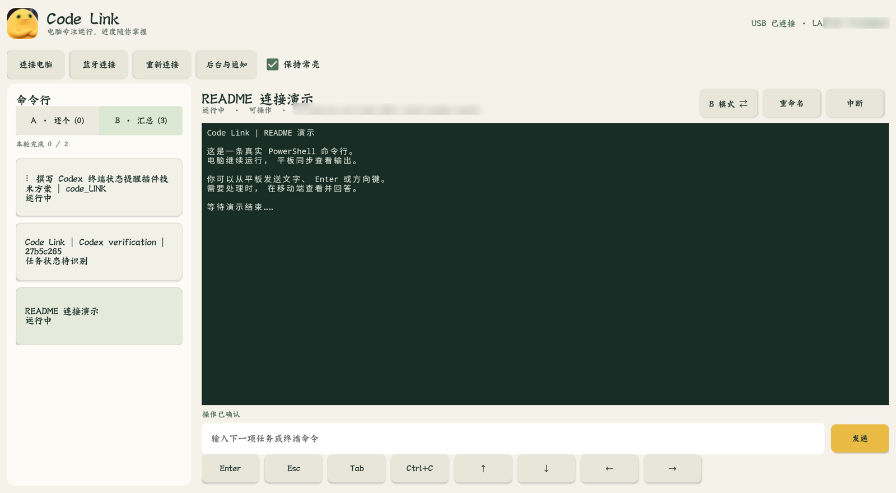
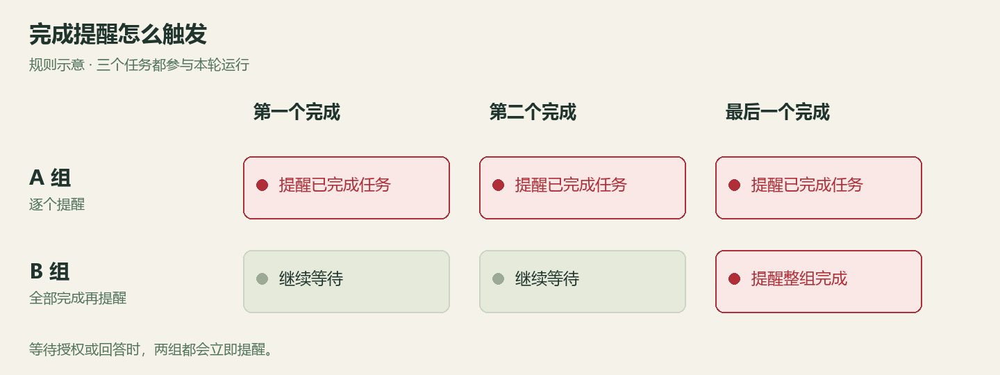
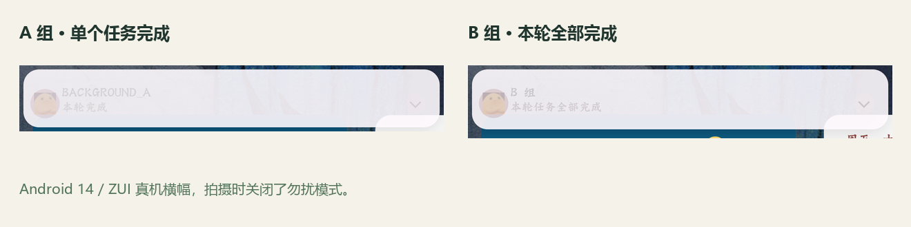
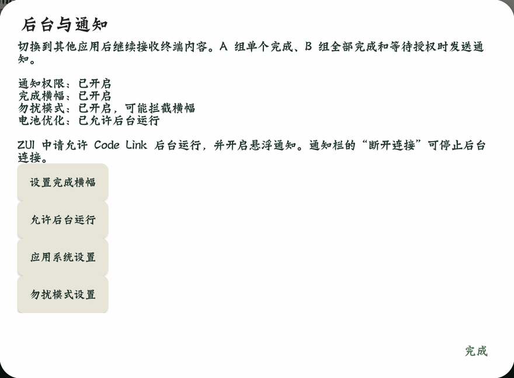
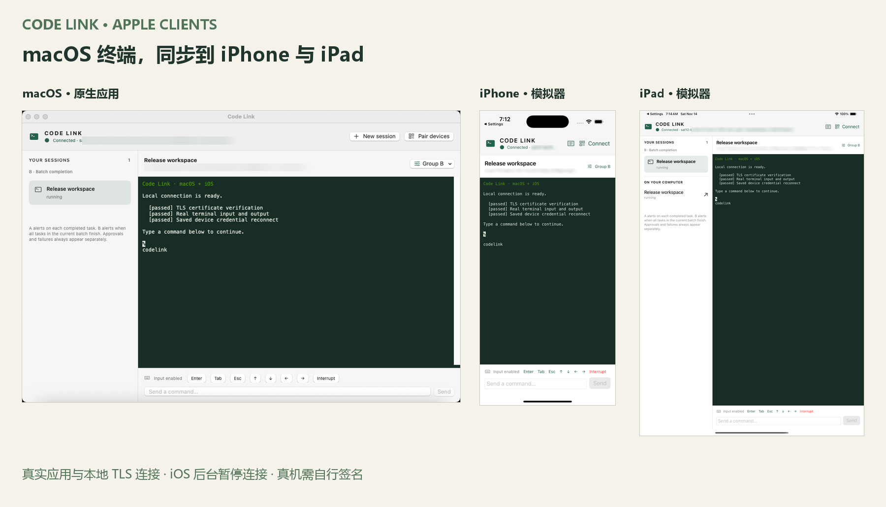

<p align="center"></p>
<h1 align="center">Code Link</h1>
<p align="center"><strong>把 Android 平板变成 Windows 终端任务看板。</strong></p>
<p align="center">本地与远程连接 · 终端输入 · Codex 授权 · 单个或整批任务提醒</p>
<p align="center"><a href="README.md">English</a> · <strong>简体中文</strong></p>
<p align="center">
<a href="https://github.com/ZARADEE/code_LINK/releases/latest"></a>
<a href="https://github.com/ZARADEE/code_LINK/actions/workflows/ci.yml"></a>
<a href="LICENSE"></a>

</p>
<p align="center">
<a href="https://github.com/ZARADEE/code_LINK/releases/latest">下载安装</a> ·
<a href="#quick-start">开始使用</a> ·
<a href="#reminders">A/B 提醒</a> ·
<a href="#background">后台与通知</a> ·
<a href="#faq">常见问题</a> ·
<a href="README.md">English</a> ·
<a href="https://zaradee.github.io/code_LINK/">项目主页</a>
</p>



运行 Codex 或其他命令行任务时，可以把电脑上的终端最小化，继续做手头的事。Code Link 把终端输出同步到 Android 平板，让你查看进度、发送输入、回答确认提示，并在任务完成或需要处理时收到提醒。

**当前源码构建新增远程连接、滑动回看与终端点击。** Windows x64 电脑作为服务器，Android ARM64 只需安装 Code Link，即可通过互联网查看和操作终端。iroh 优先尝试直连，必要时使用免费公共中继，无需租服务器或安装 VPN。手机和平板都可以滑动查看前文、同步滚动电脑窗口，并轻点终端里的 Back to bottom。已实测热点和移动数据下的跨网输入、滑动与点击，以及平板拔线熄屏后的完成提醒；整夜稳定性仍待验证。下方下载链接仍为稳定版 v1.4.1，新功能可按[远程预览构建与使用说明](docs/REMOTE.md)体验。

USB、蓝牙和局域网连接保留作为备用。近距离连接无需公共中继；终端里的任务仍使用电脑原有的网络连接。

适合在电脑旁用 Android 平板照看多个终端，在任务运行期间继续处理其他工作。现有窗口可以直接接入；需要可靠的 Codex 授权卡片与回合事件时，使用随包提供的 `clink codex`。

[安装速查](docs/INSTALL.md) · [下一步计划](docs/ROADMAP.md) · [项目主页](https://zaradee.github.io/code_LINK/)

## 什么情况下最适合用它

你在 Windows 上同时运行 Codex、构建和测试，又不想反复切换终端窗口。Code Link 把手边的 Android 平板变成独立任务看板，让你查看输出、处理授权，并在单个任务或整批任务完成时收到提醒。本地连接，无需账号或云端中继。

- **写代码时，Codex 又在等确认。** 在平板上看清提示并回答。已有 Codex 窗口可以直接接入；需要结构化授权卡片和回合状态时，用 `clink codex` 启动。
- **几项独立任务同时运行。** 给终端命名，A 组分别提醒，B 组等本轮参与的任务全部成功后统一提醒。失败、中断和未知状态不会冒充成功。
- **手边有块闲置平板。** 用 USB 放在编辑器旁当任务看板；临时切到其他 Android 应用时，由前台服务继续接收支持的状态提醒。
- **离开电脑后还想看任务进度。** 使用源码预览版，让电脑保持开机、不睡眠，在其他网络打开移动端 Code Link，任务继续由自己的电脑运行。

目前最成熟的使用方式是 **Windows 与桌边的 Android 平板**，重点在已有窗口接入、本地 USB / 蓝牙、终端输入与整批提醒的组合。需要完整图形窗口时可用副屏，需要远程服务器管理时可用 SSH；Code Link 适合把本机终端任务交给已有平板照看。Mac 管理应用内创建的终端，iOS 是开发预览，具体范围见下文。

**[按场景上手：Codex 授权、并行任务与闲置平板 →](https://zaradee.github.io/code_LINK/windows-android-terminal.html)**

## 你可以用它做什么

| 使用场景 | Code Link 的操作 |
| --- | --- |
| 终端被其他窗口遮住了 | 在平板上查看对应终端的最新输出 |
| 有几条任务同时运行 | 用 A/B 标签分组，按单个任务或整组完成接收提醒 |
| Codex 等待授权或回答 | 从平板查看请求、提交回答，或用按键响应原终端提示 |
| 需要追加一句输入 | 发送文字，或使用 Enter、Esc、Tab、方向键、Ctrl+C |
| 平板切到了其他 App | 后台继续接收状态，完成时弹出系统横幅 |
| 想收起电脑上的面板 | 关闭窗口收进托盘，原来的命令行继续运行 |
| 想翻看前面的输出 | 源码预览版支持滑动回看，也可带动电脑终端滚动 |

## 先选择你的使用方式



从平板发送指令后，电脑执行本项目真实的文档和英文翻译检查，输出回到平板，任务退出后出现 A 模式完成提醒。动图由四张中文客户端 USB 真机截图组成，展示时间经过缩短。[查看静态结果](docs/assets/workflow-complete.png)。

| 你的设备 | 当前可用的方式 | 从这里开始 |
| --- | --- | --- |
| Windows + Android 平板 | 已有终端同步、输入、USB / 蓝牙和 Android 后台提醒；已有真机验收 | [下载中文 Windows 包](https://github.com/ZARADEE/code_LINK/releases/download/v1.4.1/CodeLink-Windows-v1.4.1-zh-CN.zip) + [Android APK](https://github.com/ZARADEE/code_LINK/releases/download/v1.4.1/CodeLink-Android-v1.4.1-zh-CN.apk) |
| Mac + Android | 在 Mac 创建托管终端或 Codex 会话，通过局域网连接；跨设备真机验收待完成 | [Apple silicon](https://github.com/ZARADEE/code_LINK/releases/download/v1.4.1/CodeLink-macOS-AppleSilicon-v1.4.1-en.zip) / [Intel](https://github.com/ZARADEE/code_LINK/releases/download/v1.4.1/CodeLink-macOS-Intel-v1.4.1-en.zip) · [Mac 说明](docs/APPLE.md) |
| iPhone / iPad | 开发预览，提供模拟器包与自行签名源码；后台暂停连接 | [Apple 安装说明](docs/APPLE.md) |

Mac 用户直接下载 Mac 应用即可，iOS 真机签名只涉及安装到 iPhone / iPad。Mac 当前管理 Code Link 内创建的终端，Windows 还支持接入已有窗口。

<a id="quick-start"></a>

## 开始使用

支持 **USB 和蓝牙**。下面的快速上手采用 USB；也可直接按下文“蓝牙连接”完成配对，无需先接数据线。

### 1. 下载安装

从 [Releases](https://github.com/ZARADEE/code_LINK/releases/latest) 获取对应平台的客户端。

| 客户端 | 下载文件 | 安装方法 |
| --- | --- | --- |
| Windows | `CodeLink-Windows-v1.4.1-zh-CN.zip` | 解压并保留完整目录，双击 `CodeLink.exe` |
| Android | `CodeLink-Android-v1.4.1-zh-CN.apk` | 复制到平板后安装，按系统提示允许该来源安装应用 |
| Windows 英文版 | `CodeLink-Windows-v1.4.1-en.zip` | 英文界面、托盘菜单、错误提示与 CLI 帮助 |
| Android 英文版 | `CodeLink-Android-v1.4.1-en.apk` | 英文界面、通知和设置；可覆盖中文版并保留应用数据 |
| macOS 14+ | `CodeLink-macOS-AppleSilicon-v1.4.1-en.zip` / `CodeLink-macOS-Intel-v1.4.1-en.zip` | 解压并放入 Applications，参见 [Apple 指南](docs/APPLE.md) |
| iOS / iPadOS 17+ | `CodeLink-iOS-Simulator-v1.4.1-en.zip` / `CodeLink-Apple-Source-v1.4.1-en.zip` | Mac 模拟器运行，或用自己的 Apple 账号在 Xcode 签名；非直接安装包 |

v1.4.1 的 Windows x64 包已包含 .NET 10 桌面运行时，无需另行安装；请完整解压后运行 `CodeLink.exe`。Android 最低安装版本为 9，窄屏手机使用列表／详情切换，宽度足够的平板同时显示两栏；旋转和调整窗口大小会保留各终端的输入草稿。

Release 同时提供 `SHA256SUMS.txt`，可按[安装说明](docs/INSTALL.md)核对下载。当前 Android 包使用开发签名，Windows 程序尚无商业代码签名；Windows / Android 提供简体中文与英文包，文件名以 zh-CN 或 en 标注。Apple 下载另附 `APPLE-SHA256SUMS.txt`。

当前真机验证设备为联想小新 Pad Pro 12.7，Android 14 / ZUI 16。Codex 使用者请先在电脑上安装、登录 Codex，并确认它能在原来的命令行中正常运行。

### 2. 用 USB 连接

1. 在平板系统设置中开启**开发者选项 → USB 调试**。入口因品牌而异，可参考 [Android 官方说明](https://developer.android.com/studio/run/device#setting-up)。
2. 用支持数据传输的数据线连接电脑和平板。平板弹出“允许 USB 调试”时，核对电脑并点**允许**。USB 用途可选**文件传输**。
3. 打开平板上的 Code Link，允许通知权限。
4. 打开电脑上的 Code Link，点击**连接设备 → USB 一键连接**。
5. 平板显示“USB 已连接”后，即可选择终端。

USB 一键连接会自动填写配对信息，无需手动输入 IP，也无需开启 USB 网络共享。

### 3. 选择要看的命令行

在电脑面板左侧选中命令行，再选中移动设备，点击**映射到移动端**。平板会切换到该终端。你也可以直接在平板列表中点击电脑扫描到的终端，让它建立映射。



*电脑端负责扫描、连接和观察。需要在电脑输入时，直接使用原来的命令行窗口。*

## 在平板上使用



左侧选择命令行，右侧查看输出。底部输入框可以发送文字，快捷键用于选择选项、确认或中断任务。选中终端后，点击**重命名**设置便于辨认的名字，点击 **A 模式 / B 模式 ⇄** 切换分组。名称与分组会在这台平板上保存。

源码预览版中，在终端内容区**下滑查看前文，上滑查看后文**。选择“滑动：同步电脑”可带动已有终端窗口滚动；切换“滑动：本地查看”只翻阅平板上的内容，新输出到来时保留阅读位置。“回到最新”用于回到普通终端的历史底部并恢复跟随。

同步滚动与点击支持 Windows Terminal 单窗格。普通命令行使用历史滚动条；全屏程序需要支持鼠标交互，并保持电脑上的窗口处于还原状态。遇到 `New activity · ↓ Back to bottom · esc`，可以直接轻点终端里的按钮，也可以按 Code Link 的“回到最新”。手机和平板使用同样的操作，滑动不会触发点击。[详细范围与验收](docs/REMOTE.md#移动端查看与滚动)。

| 需要处理的内容 | 操作方法 |
| --- | --- |
| 原命令行里的确认问题或选项 | 用文字、方向键和 Enter 回答，操作回到原终端 |
| Code Link 的待处理卡片 | 点击**查看并处理**，阅读请求后允许、拒绝或填写回答 |

待处理卡片来自通过 `clink codex` 启动的 Codex 会话。点击红点只是确认“我看到了”，执行授权仍需单独操作。

<a id="reminders"></a>

## A/B 完成提醒

**新终端默认归入 B 组。** 两种模式决定什么时候通知你。



| 模式 | 什么时候提醒 | 适合的用法 |
| --- | --- | --- |
| **A · 逐个** | 每个任务完成后分别提醒 | 完成一项就想立即接着处理 |
| **B · 汇总** | 本轮参与运行的任务全部完成后提醒 | 几项任务一起跑，等全部结束再看 |

B 组统计本轮实际运行过的任务。未启动的空闲窗口不会阻塞汇总；失败、中断、断线和状态未知不会算作成功完成。等待授权或回答时，两组都会立即单独提醒。

B 组在全部完成时才同时标红标签和本轮成员。逐个点击查看会清除各自红点，**最后一个完成红点清除时，B 标签和对应系统通知也一起消除**。点击汇总行可以一次确认整组完成提醒。已读状态在重启后保留。

<a id="background"></a>

## 后台与通知

连接建立后，可以切到其他 App。Code Link 会继续接收状态和终端输出，通知栏显示安静的“Code Link · 后台连接”。A 组单个完成、B 组全部完成或需要处理时，会通过独立通知提醒你。



首次使用请打开 App 顶部的**更多 → 后台与通知**。

1. 允许通知权限，并在**设置完成横幅**中开启横幅或悬浮通知。
2. 点击**允许后台运行**，按系统提示放行电池优化限制。
3. 想看到横幅时关闭勿扰；使用 ZUI 等带后台管理的系统时，同时允许 Code Link 后台运行。

<p align="center"></p>

点击 A 组完成通知会打开对应终端，点击 B 组汇总通知会进入 B 页。返回 App 时，页面会显示后台期间收到的最新内容。熄屏时通知留在系统通知中心，锁屏展示遵循系统的隐私设置。

需要结束后台连接时，点击常驻通知中的**断开连接**。电脑端关闭面板会收进托盘；要继续同步已有终端，请让托盘程序保持运行。

## 连接方式

| 方式 | 使用前提 | 当前情况 |
| --- | --- | --- |
| **USB，推荐首次使用** | 数据线、USB 调试、电脑授权 | 已验证双向输入、后台连接、完成横幅和熄屏通知 |
| **蓝牙** | 两端支持蓝牙，已在系统中配对 | 已验证终端内容与输入、确认操作及重连 |
| **同一局域网 / Wi-Fi** | 两端网络互通，电脑端允许局域网连接 | 功能已实现，真机直连仍待验收 |
| **互联网远程，源码预览** | Windows x64 / Android ARM64，电脑开机且不睡眠 | 手机热点与校园网之间已验证输入、滑动和熄屏提醒；自动选择直连或免费公共中继 |

<details>
<summary><strong>远程连接：电脑作为服务器</strong></summary>

1. 按[源码构建说明](docs/REMOTE.md#构建与复用工具链)安装两端预览构建。
2. Windows 打开设备配对窗口，点击**开启远程连接**，等待入口就绪。
3. Android 点击**连接电脑 → 扫描二维码**，扫描电脑上的远程配对码。初次邀请有效期为 10 分钟；配对后可直接重连。
4. 手机或平板可以切换到其他 Wi-Fi、热点或移动网络。电脑保留 Code Link 托盘程序并保持联网、不睡眠。

“直连”指通过互联网在两端之间传输加密数据，不要求处于蓝牙范围或同一局域网。网络条件不允许穿透时，由公共中继转发加密数据；任务仍在电脑上运行。公共中继免费、共享且限流，不保证持续可用。参见[方案与实测记录](docs/REMOTE.md)。

</details>

<details>
<summary><strong>蓝牙连接与切换</strong></summary>

1. 在 Windows 和 Android 系统蓝牙设置中完成设备配对，并保持两端 Code Link 打开。
2. 如果已经通过 Code Link 配对过，Android 点击 **更多 → 蓝牙连接**，允许“附近的设备”权限并选择电脑，即可切换。
3. 首次应用配对时，Windows 点击 **连接设备 → 蓝牙连接**，原有配对区域会展开。Android 点击 **连接电脑 → 蓝牙**，扫码或粘贴电脑的配对信息，再选择已配对的电脑。
4. 确认 Android 显示“蓝牙已连接”，Windows 配对窗口也会显示实际通过蓝牙连接的设备。打开测试终端并发送 `echo hello` 检查输入。

蓝牙首次应用配对不要求先使用 USB。授权被拒绝时可从提示打开应用设置；找不到电脑时，从设备选择窗口进入系统蓝牙设置，配对后返回刷新。配对码过期时，在 Windows 刷新后重新扫码。

蓝牙使用设备间直连，**不需要加入个人局域网 PAN**。终端内容较多时，优先使用 USB。

</details>

<details>
<summary><strong>如何尝试局域网连接</strong></summary>

电脑和平板接入能够互相访问的局域网。电脑端点击**连接设备**，从地址下拉框选择电脑的局域网 IP；平板端点击**连接电脑**，扫描二维码或粘贴配对信息，选择 **Wi-Fi** 后连接。

同一个 Wi-Fi 名称不一定表示设备能够互访。校园网、访客网络和开启设备隔离的路由器可能阻止连接；电脑防火墙也需要允许该应用的入站连接。遇到这种情况可以改用 USB。

</details>

## 从指定目录启动终端

在解压后的 Windows 程序目录打开 PowerShell，将下面的 `D:\project` 替换为实际存在的工作目录。

```powershell
# 打开该目录下的 PowerShell 窗口
.\clink.exe terminal --cwd "D:\project" --name "项目终端" --new-window

# 启动支持结构化授权和完成事件的 Codex 会话
.\clink.exe codex --cwd "D:\project" --name "项目助手" --new-window
```

`clink codex` 使用电脑上已有的 Codex 安装与登录状态，提供 Code Link 自己的文本前端。源码目录中的入口位于 `dist/desktop/clink.exe`。

<a id="faq"></a>

## 常见问题

<details>
<summary><strong>电脑找不到平板，或 USB 一直连接不上</strong></summary>

先解锁平板，确认 USB 调试仍然开启，并允许电脑的调试授权。将 USB 用途切到文件传输，重新插拔数据线后，再点一次 USB 一键连接。如果没有授权弹窗，检查数据线能否传输文件，以及 Windows 是否正确识别了设备驱动。

需要进一步检查时，在 Windows 程序目录运行下面的命令。

```powershell
.\tools\adb.exe -P 5037 devices -l
.\tools\adb.exe -P 5038 devices -l
```

`device` 表示已授权，`unauthorized` 表示需要在平板确认。没有设备则先检查数据线、接口和驱动。

</details>

<details>
<summary><strong>为什么有的终端显示“任务状态待识别”</strong></summary>

任意外部命令行没有统一的“本轮完成”事件。Code Link 会识别已适配的 Codex 运行、授权和结束画面；没有足够标记时保留待识别状态，终端文本仍可查看。

需要明确的 Codex 回合完成与授权事件时，使用 `clink codex`。通过 `clink terminal` 运行的有限程序按退出码判断完成；交互式 PowerShell 窗口仍在运行时，其中每条命令的结束不会自动视为整个终端完成。

</details>

<details>
<summary><strong>为什么电脑上有窗口，平板却打不开或无法输入</strong></summary>

点击电脑端的**扫描**刷新列表，确认目标窗口仍然存在。已有 Windows Terminal 窗口的映射跟随它当前的活动标签页；切换标签页后，观察对象也会变化。需要分别观察时，请使用独立窗口。

目标终端权限高于 Code Link、窗口标题重复导致目标不明确，或终端没有标准控制台接口时，输入可能被拒绝。按面板提示调整权限或窗口标题后重试。

</details>

<details>
<summary><strong>任务完成了，为什么没有横幅或 B 组没有标红</strong></summary>

先确认终端是否被识别为完成。B 组还要等待本轮其他参与任务全部成功结束；等待授权、失败、断线和未知状态都会阻止成功汇总。

如果 App 内已经出现完成红点，再进入**后台与通知**检查通知权限、完成横幅与勿扰设置。系统禁止通知或开启勿扰时，横幅可能不会显示。

</details>

<details>
<summary><strong>切到后台以后应该保留哪些程序</strong></summary>

电脑保留 Code Link 托盘程序，Android 允许后台运行，并保留“后台连接”服务。强行停止 App、手动停止服务会影响实时接收；USB 模式下拔线也会中断连接，远程模式不依赖数据线。链路恢复后应用会尝试重连。

平板断开时，电脑上的任务继续运行。重连后会同步最新状态，未确认的输入不会自动重复发送。

</details>

## macOS 与 iOS



macOS 应用与 iPhone / iPad 模拟器的实际运行截图。可查看 [Mac](docs/assets/macos.png)、[iPhone](docs/assets/ios.png) 和 [iPad](docs/assets/ipados.png) 原尺寸图片。

新增原生 SwiftUI 客户端。macOS 可以创建 zsh 终端和 Codex 会话，iPhone / iPad 通过同一局域网连接 Mac 或 Windows，查看输出、输入指令、处理审批和 A/B 提醒。Apple 端界面为英文，详见 [Apple 安装与功能说明](docs/APPLE.md)。

macOS 提供 Apple silicon 和 Intel 包，内含 .NET 运行时，尚未进行 Developer ID 签名与公证。iOS 提供模拟器包、未签名真机归档和可自行签名的 Xcode 工程；当前没有可直接安装的签名 IPA 或 TestFlight。iOS 退到后台后会暂停连接，返回时重连。下文 USB、蓝牙、后台常驻与外部窗口扫描步骤适用于 Windows + Android。

## 兼容范围与验证

支持 **Windows + Android**，以及 **macOS 14+ / iOS 17+** 原生客户端。Apple 端支持 LAN 和托管终端，iOS 后台暂停连接；当前提供模拟器与自行签名工程。Linux 和 WSL 尚未完成适配或验收。Android 最低版本为 9，真机验收基于 Android 14 / ZUI 16。

外部终端同步的是可读取的文本，保留换行与空格；原终端的全部配色、光标效果和无限历史记录不在当前同步范围内。输出缓存最多约 12 万字符。

已在真机上验证 USB 和蓝牙的终端输入与确认操作，以及 USB 下的 A/B 横幅、后台接收、页面回收后连接、熄屏通知和解锁后内容恢复。一轮 USB 连续连接记录为 **89 分钟**。局域网直连、蓝牙锁屏和更长时间的耗电表现仍需持续验证。

详细结果见[当前实现与验收记录](docs/implementation.zh-CN.md)和[后台通知验收数据](research/pad-background-acceptance.json)。

## 帮助、参与和许可

想了解项目怎样工作、重点代码在哪里、怎样继续开发，可以先读 [if_want_learn.md](if_want_learn.md)。文档从一条手机输入如何到达电脑终端讲起。

遇到问题请[提交 Issue](https://github.com/ZARADEE/code_LINK/issues/new/choose)，附上两端系统版本、App 版本、连接方式、终端类型和复现步骤。截图前遮住配对二维码、密钥和私人终端内容。

- [贡献指南](CONTRIBUTING.md) · [社区规范](CODE_OF_CONDUCT.md) · [安全问题](SECURITY.md) · [版本记录](CHANGELOG.md)
- [从源码构建](docs/BUILDING.md) · [当前实现](docs/implementation.zh-CN.md) · [开发记录](docs/development-status.md) · [初始技术方案](docs/technical-proposal.zh-CN.md)
- 项目代码采用 [MIT 许可证](LICENSE)。图片、动画和第三方组件的授权范围见 [素材说明](assets/README.md)与[第三方声明](THIRD_PARTY_NOTICES.md)。

维护者为 [ZARADEE](https://github.com/ZARADEE)。本项目为独立开发的终端伴随工具。

*Windows 与平板主界面于 2026-11-14 实际连接后拍摄，通知来自既有真机记录；规则图为说明示意。本机路径、设备名和私人窗口标题已模糊。[图片来源](docs/assets/README.md)。截图展示已发布界面；远程连接与滑动控件在文中标注为源码预览功能。*
