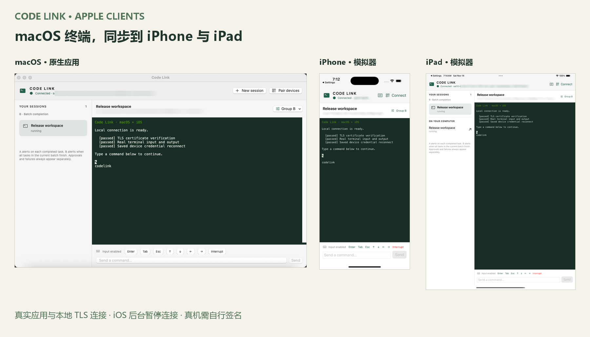

# Code Link for macOS and iOS

## 中文安装速查

macOS 需要 14 或更新版本，iPhone / iPad 需要 iOS / iPadOS 17 或更新版本。Apple 客户端目前使用英文界面。

1. 从 Releases 下载适合芯片的 Mac ZIP，解压并将 `CodeLink.app` 放入 Applications。包内已含 .NET 运行时。Mac 应用尚未公证，系统阻止打开时，可在确认下载来源与校验值后，通过“系统设置 → 隐私与安全 → 仍要打开”允许该应用。
2. 打开 Mac 应用，点击 **New session**，创建终端或 Codex 会话。Codex 需提前在 Mac 上安装并登录。
3. 点击 **Pair devices**，打开 **Allow connections on the local network**，确认电脑 IP 地址。
4. 在 iOS 客户端点击 **Connect → Scan QR**，扫描电脑配对二维码，允许相机与本地网络访问。也可复制并粘贴配对邀请。
5. 从手机的会话列表打开终端，或在 Mac 会话菜单中将它共享给已配对设备。A 组逐个完成提醒，B 组整批完成提醒；审批与失败单独显示。

**iPhone 安装条件**：当前提供 iOS 模拟器包、未签名真机归档和 Xcode 工程，没有可直接安装的签名 IPA 或 TestFlight。真机测试需在自己的 Mac 上打开源码工程，选择 `CodeLinkiOS`，将 **Code Signing Allowed** 改为 **Yes**，开启自动签名并选择自己的 Apple 开发团队。普通 Apple 账号可在 Apple 免费签名限制内进行个人真机测试。未签名归档不能直接安装到 iPhone。

**运行范围**：Apple 端使用局域网；iOS 进入后台后暂停连接，返回前台时重连。Mac 只共享 Code Link 中创建的托管终端。Windows 的外部窗口扫描、Android 的 USB / 蓝牙与后台常驻不适用于 Apple 端。退出 Mac 应用会停止其托管终端；需要手机持续操作时请保持 Mac 应用运行。

The Apple clients use the same TLS protocol as Windows and Android. macOS hosts managed zsh terminals and local Codex CLI sessions. iPhone and iPad connect over your local network to a Mac or Windows host.

Requirements: macOS 14 or newer; iOS / iPadOS 17 or newer. macOS packages are provided for Apple silicon and Intel.



## Downloads and signing

The macOS application is ad-hoc signed, without an Apple Developer ID or notarization. Download it from this repository's release, unzip it, and move CodeLink.app to Applications. If macOS blocks it, use System Settings → Privacy & Security → Open Anyway after checking the release checksum. Do not disable Gatekeeper globally.

There is no signed iPhone IPA or TestFlight release. `CodeLink-iOS-Simulator` runs in Xcode's iOS Simulator on a Mac. `CodeLink-iOS-unsigned-archive` is an unsigned device archive for developers; it cannot be installed directly on an iPhone. `CodeLink-Apple-Source` contains an Xcode project for personal signing. Open `apple/CodeLink.xcodeproj`, select CodeLinkiOS, set **Build Settings → Code Signing Allowed** to **Yes**, enable automatic signing, select your own development team and bundle identifier, and run on a connected device. A free Apple Account can be used for personal device testing under Apple's provisioning limits. App Store / TestFlight distribution needs paid Apple Developer Program membership.

## First connection

To run the simulator download, unzip it, open Xcode's Simulator and start an iPhone or iPad. Install and launch the app with:

```sh
xcrun simctl install booted /path/to/CodeLink.app
xcrun simctl launch booted com.codelink.ios
```

1. Open the Mac app and create a terminal or Codex session. Codex requires a separately installed, authenticated Codex CLI.
2. Open Pair devices, enable local network connections and check the displayed Mac IP address.
3. Open the iOS app on the same network. Scan the pairing QR code or paste its invitation. Allow camera and local network access when prompted. Verify the certificate fingerprint against the computer.
4. Open a session from the phone's command list. You can also share a session with a paired device from the Mac session menu.
5. Use the terminal, command composer and approval cards. Assign sessions to group A for individual completion reminders, or group B for one reminder when a batch finishes. Approvals and failures alert separately.

macOS keeps its host and terminals alive while Code Link is open. Quitting the Mac app stops its host and managed terminals. Keep it open when using the phone. Pairing secrets are encrypted with a key stored in macOS Keychain; iOS stores its device credential in Keychain.

For terminal completion reminders, create a session with a command that exits when its task finishes, such as a build or test command. An interactive zsh shell remains running until you exit it; Code Link does not infer individual command completion from its prompt. Codex sessions report completion for each turn.

## Platform differences

| Capability | macOS / iOS support |
| --- | --- |
| Managed terminals, streaming output and input | Yes, macOS zsh PTY with iOS companion |
| Codex prompts, approvals, questions and interruption | Yes, using local Codex CLI on the host |
| A/B grouping, unread state and local notifications | Yes, while connected |
| Arbitrary external terminal window capture | Windows host only; macOS shares sessions created in Code Link |
| USB ADB / classic Bluetooth transport | Android + Windows only; Apple clients use LAN TLS |
| iOS background connection | Suspended in background; reconnects on return; intermediate events may be missed |
| Push notifications while iOS is suspended | Not included; no cloud push service |
| Developer ID notarization / TestFlight | Not available in this release |

## Build and verification

Install Xcode, its command-line tools, .NET 10 SDK and XcodeGen (`brew install xcodegen`) on a Mac. Run `bash scripts/build-apple.sh` from the repository root. Output is in `dist/apple`. The script builds both Mac architectures, an iOS simulator app, an unsigned iOS device archive and a source archive. It runs protocol / reminder checks and exercises the real macOS host.

The GitHub Apple workflow performs the same build on macOS. Build logs, checksums and screenshots are uploaded as workflow artifacts. Unsigned archives are clearly separated from runnable simulator packages.

Apple references: [distribution options](https://developer.apple.com/documentation/xcode/distributing-your-app-for-beta-testing-and-releases), [free account and program comparison](https://developer.apple.com/support/compare-memberships/), [opening apps safely](https://support.apple.com/en-us/102445).
