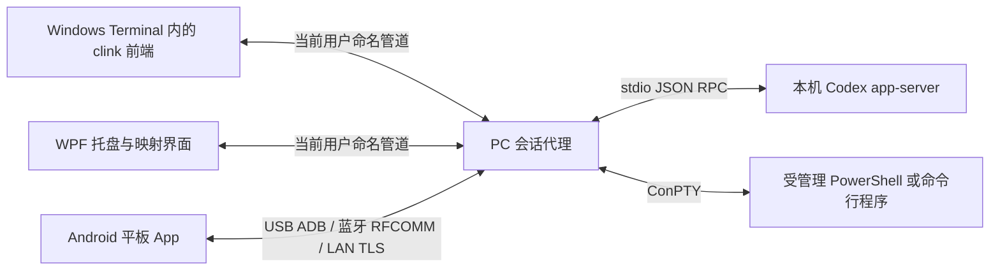
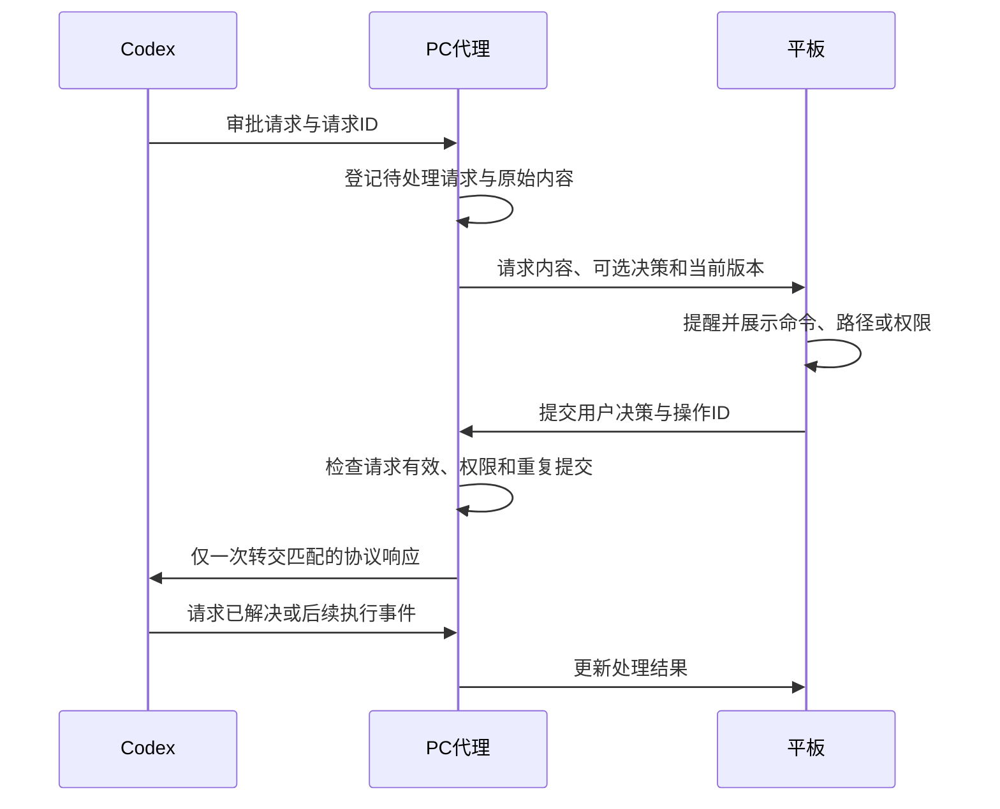

# Code Link 技术方案

> 这是初始方案存档。开发中已按用户最新要求改为统一命令行列表，并增加现有 Windows 终端的移动输入和提示交互；Android 实际采用 Java 原生 View。当前实现、交付包、测试证据与剩余工作以 [当前实现说明](implementation.zh-CN.md) 为准。以下的拟定指标不能作为已通过验收的成绩。

版本 1.0，2026 年 11 月 13 日。项目暂名 Code Link。

首版目标设备为 Windows PC 和联想小新 Pad Pro 12.7，设备实测型号 TB371FC，系统为 Android 14 / ZUI 16.0.474。本文中的客户端、APK 和 `clink` 命令为拟开发内容。

## 1. 推荐实施方案

采用 **Windows 原生托盘程序 + Android 原生 App + PC 本地会话代理**。计算、Codex 登录、命令执行和会话状态均保留在 PC，平板负责查看、提醒和提交交互。

| 部分 | 选型 | 选择理由 |
| --- | --- | --- |
| PC 主界面 | C#、.NET 10 LTS、WPF | 首版限定 Windows，方便使用原生终端、蓝牙和系统托盘接口 |
| PC 本地代理 | 独立 .NET 后台进程 | UI 收起、终端最小化或平板断线时，继续维持会话 |
| Android App | Kotlin、Jetpack Compose | 直接使用 Android 蓝牙、USB 联调、通知和生命周期接口 |
| Codex 接入 | 本机官方 `codex app-server`，stdio | 获取结构化输出、回合状态和审批请求 |
| 普通终端接入 | Windows ConPTY | 托管终端输入输出，支持本地和移动端操作 |
| 数据线 | USB ADB reverse | 用户已接受 USB 调试，且本次真机双向数据测试通过 |
| 蓝牙 | Bluetooth Classic RFCOMM | 不依赖热点、PAN、Wi-Fi 或云端 |
| 同一局域网 | TCP + TLS、NSD/mDNS、二维码回退 | 直接连接 PC，复用同一套业务协议 |

这里“无需服务器”指无需另租云服务器、无需第三方中继。PC 上会运行一个本地监听进程，由它接收平板连接。Codex 自身访问模型服务的网络需求另行沿用现有配置。

**架构具有公开实现路径；本机 Codex 协议握手和真机 USB 数据通道已经验证。蓝牙互通、App 审批闭环和长时间稳定性列入开发原型的验收条件。**

## 2. 已确定的需求与首版范围

用户已确认采用独立托盘小工具，可以从工具或专用命令启动需要映射的终端；首版平板保持 App 前台或常亮，接受 USB 调试，日常使用 Windows 原生 PowerShell / Windows Terminal。

首版需要实现以下闭环。

1. PC 查看设备、连接方式、会话名称和当前状态。
2. 从 PC 创建受管理会话，选择映射给哪台设备。
3. 平板查看实时输出、命令执行情况、最近活动和连接状态。
4. Codex 回合结束、失败、等待审批或需要用户回答时，平板弹出相应提示。
5. 在平板查看审批内容并提交允许、拒绝或取消；发送问题回答和后续任务。
6. USB、蓝牙和局域网共享会话映射；断开连接不会自动停止 PC 上的任务。
7. PC 可以随时收回移动端控制权。

首版支持一个 PC、最多两个观察设备、最多五个已映射会话，每个会话同时只有一个移动端控制者。上述数量为设计与验收范围，可通过后续压测扩展。

首版交付 Windows x64 程序和可侧载安装的 Android APK。Android App 可以在 Windows 上编译，无需 Mac。iPad、WSL、远程公网连接和锁屏后的持续提醒作为后续项目范围。

## 3. 本次实际验证结果

### 3.1 USB 已经连通

用户在平板允许 USB 调试后，本机 ADB 成功识别设备。

| 检查 | 实测结果 |
| --- | --- |
| ADB 状态 | `device`，已授权 |
| 设备型号 | `TB371FC` |
| Android 版本 | `14` |
| 系统构建 | `TB371FC_CN_OPEN_USER_Q00028.1_U_ZUI_16.0.474_ST_241129` |
| 物理通道确认 | `adb -d` 选择到同一设备，确认使用 USB |
| ADB reverse | 临时端口映射创建成功 |
| 平板 → PC | 1024 字节测试内容完整校验通过 |
| PC → 平板 | 确认消息完整回传并校验通过 |
| 清理 | 测试创建的端口映射已移除 |

测试采用平板系统自带的 TCP 工具作为客户端，没有安装 APK，也没有修改系统设置。结果证明这台设备可使用 USB 双向传输；App UI、提醒和 Codex 审批尚未由这项测试覆盖。

原始记录见 [USB 验证记录](../research/usb-link-evidence.json)，验证程序见 [verify-usb-link.cjs](../research/verify-usb-link.cjs)。

### 3.2 Codex 接入基础已经具备

本机版本为 `codex-cli 0.166.0`。已经从该版本导出 JSON Schema，并成功完成独立 app-server 的 stdio 初始化握手，进程正常退出。过程没有调用模型或执行任务。

Schema 确认存在回合完成、消息增量、命令输出、命令审批、文件审批、权限审批和用户问题等接口。版本和字段证据见 [Codex 验证记录](../research/local-codex-evidence.json)。具体实现以此版本 Schema 为准，升级 Codex 时执行兼容性检查。

依据为 [Codex app-server 官方文档](https://developers.openai.com/codex/app-server/)。

### 3.3 蓝牙和无线调试的当前状态

Windows PnP 记录中存在用户指定的 Zaradee 设备，蓝牙硬件为 Intel Wireless Bluetooth。本次读取到的 PAN 适配器状态是 `Disconnected`，尚未建立本项目的 RFCOMM 业务连接。

用户提供的 `10.152.56.63:43585` 是无线 ADB 连接地址。一次限时 TCP 探测未成功建立连接，尚未完成无线 ADB 配对，因此不据此认定局域网功能不可用。首版 USB 已有实测可用路径，无线调试不构成开发前置阻塞。

## 4. 连接方式与 PAN 的作用

### 4.1 连接矩阵

| 方式 | 是否需要云端 | 设备前提 | 产品定位 | 当前证据 |
| --- | --- | --- | --- | --- |
| USB + ADB reverse | 否 | 数据线、USB 调试、电脑授权、ADB 驱动 | 首版有线主通道 | 本机真机双向测试通过 |
| 蓝牙 RFCOMM | 否 | 两端蓝牙、系统配对、App 自定义服务 | 首版无线通道 | 两端官方 API 可用，待 App 互通测试 |
| 同一 Wi-Fi / 可互通局域网 | 否 | PC 与平板之间 TCP 可达 | 首版推荐无线方式 | 官方网络发现 API 与 TCP/TLS 可实现 |
| PC 或平板提供 Wi-Fi 热点 | 否 | 设备支持热点且双方互通 | 没有路由器时的补充 | 复用局域网通道，待真机验证 |
| 蓝牙 PAN | 否 | 一端提供蓝牙网络共享，另一端加入 | 可选 IP 通道 | 当前适配器未连接 |
| USB 网络共享 | 否 | 平板固件开放该功能、Windows 驱动可用 | 可选 IP 通道 | 尚未验证 ZUI 是否开放 |
| USB AOA | 否 | 设备支持 accessory、PC 驱动与 USB 访问适配 | 将来取消 ADB 的候选 | 官方存在协议，具体硬件和驱动待验证 |
| Wi-Fi Direct | 否 | 两端发现、组网、权限与驱动兼容 | 后续研究 | 不列入首版验收 |

同一局域网值得纳入首版。PC 可以有线接路由器，平板通过 Wi-Fi 接同一路由器；关键条件是两端可互相访问。访客网络、无线客户端隔离和跨 VLAN 策略可能阻止直连，二维码只能绕过发现失败，不能绕过网络隔离。

### 4.2 “加入个人局域网 PAN”能做什么

PAN 可以把蓝牙链路呈现为网络接口。连接成功后，PC 与平板之间有 IP 通道，就可以运行本项目的加密连接。

Windows 的“加入 PAN”入口需要平板提供蓝牙网络共享。小新 Pad 的具体 ZUI 功能尚未验证，菜单本身不能证明平板已经提供服务。普通第三方 Android App 也不能把用户没有开放的系统共享功能当成一定可调用的能力。

因此，**本项目的蓝牙功能采用 RFCOMM，PAN 作为系统成功组网后的额外入口**。用户可以保持已有蓝牙配对，不必先把 PAN 配置成功。

依据为 [微软 PAN 说明](https://support.microsoft.com/en-gb/windows/hardware/bluetooth/connect-to-a-bluetooth-network-in-windows)、[Android 蓝牙连接](https://developer.android.com/develop/connectivity/bluetooth/connect-bluetooth-devices) 和 [Windows RFCOMM](https://learn.microsoft.com/en-us/windows/apps/develop/devices-sensors/send-or-receive-files-with-rfcomm)。

### 4.3 USB 的具体实现

正式功能由 PC 在本地监听业务端口。以 `47631` 为示例：

```powershell
adb -s <USB设备序列号> reverse tcp:47631 tcp:47631
```

平板 App 连接自己的 `127.0.0.1:47631`，ADB 经 USB 把流量送至 PC 监听器。连接建立后仍执行本应用的配对和鉴权。

产品中自动选择空闲端口，按设备序列号管理映射；这里的固定端口仅供说明。插拔后重建设备对应的映射，退出时只移除本工具创建的映射，避免影响 Android Studio 等工具。PC 同时处理 IPv4 / IPv6 本地回环地址，防止 localhost 地址族差异导致连接失败。

USB 连接不要求 Wi-Fi、平板热点或 SIM 卡。PC 使用系统已经适配的 ADB 驱动；若后续电脑缺少驱动，引导使用设备厂商官方驱动。本次设备已被 ADB 识别，无需为这台电脑额外安装驱动。

依据为 [ADB reverse 手册](https://android.googlesource.com/platform/packages/modules/adb/+/refs/heads/main/docs/user/adb.1.md) 和 [Android OEM 驱动说明](https://developer.android.com/studio/run/oem-usb)。

### 4.4 蓝牙的具体实现

PC 发布一个本项目独有的 RFCOMM 服务 UUID，Android App 从已配对的电脑中选择目标并连接。Windows 使用 `RfcommServiceProvider` / `StreamSocketListener`，Android 使用安全的 `createRfcommSocketToServiceRecord`。

首版由平板主动连接 PC，不要求平板长期开启可发现状态。连接操作在后台 I/O 线程执行，关闭发现扫描后再进行连接；断开后退避重连。使用安全 RFCOMM 链路，并额外完成本应用的设备鉴权。

蓝牙优先发送状态、审批和用户输入，批量发送终端文本。持续大日志按需分页，避免挤占交互通道。纯文本命令行适合这条链路；首版不传桌面视频。

实现参考 [微软 RFCOMM Chat 示例](https://learn.microsoft.com/en-us/samples/microsoft/windows-universal-samples/bluetoothrfcommchat/)。其 Windows 示例不能替代本项目与 Android 真机的互通验收。

### 4.5 局域网的具体实现

PC 在用户选定的局域网接口监听 TLS 端口，平板通过 NSD/mDNS 发现 `_codelink._tcp` 服务，也可扫描 PC 的配对二维码或手动填写 PC 地址。mDNS 数据只包含连接信息和协议版本，不包含终端输出与授权密钥。

Wi-Fi 连接使用本项目 App 的业务端口。用户提供的无线 ADB 端口仅用于安装和联调，不写入产品业务配置。更换 Wi-Fi、IP 改变或网卡切换时重新发现，必要时重新扫码。

依据为 [Android NSD](https://developer.android.com/develop/connectivity/wifi/use-nsd)。

## 5. 为什么选择原生客户端

### 5.1 PC 选型比较

| 方案 | 适用性 | 本项目判断 |
| --- | --- | --- |
| WPF + .NET 10 | Windows 原生界面，便于调用 ConPTY 和 WinRT 蓝牙接口 | 首选，桌面主体不依赖浏览器引擎 |
| Tauri 2 + Rust | 系统 WebView、跨桌面平台，能复用 Web 前端 | 可行备选，若明确增加 macOS / Linux 再评估 |
| WinUI 3 | 原生 Windows 界面和现代控件 | 可行，首版没有必须依赖的能力 |
| Qt / C++ | 原生跨平台，设备通信能力成熟 | 可行，需承担 C++ 工程维护和依赖分发工作 |

WPF 主窗口负责设备、映射、状态和结构化消息。托盘使用系统通知区域接口。普通终端页面可以按需加载本地打包的 xterm.js / WebView2，关闭页面后释放，避免托盘常驻时启动终端渲染器。

采用 WPF 的依据是目标平台和系统接口匹配度。实际资源占用通过验收测量；Tauri 使用系统 WebView，也不能仅凭安装包大小推断运行内存。

参考 [WPF 官方说明](https://learn.microsoft.com/en-us/dotnet/desktop/wpf/overview/)、[.NET LTS 生命周期](https://dotnet.microsoft.com/en-us/platform/support/policy/dotnet-core)、[Tauri WebView 说明](https://tauri.app/reference/webview-versions/) 和 [xterm.js](https://xtermjs.org/)。

### 5.2 Android 选型

采用 Kotlin + Jetpack Compose，使用原生蓝牙、通知和网络 API。结构化 Codex 页面全部使用原生组件。原始终端镜像页面按需加载本地 xterm.js，其他界面不依赖 WebView。

首版以 Android 14 真机验收。最低系统版本建议设为 Android 8 / API 26；若发行时决定支持其他版本，应补充对应权限与生命周期测试。首版侧载 APK，无需依赖 Google Play 服务。

## 6. 会话架构与命令行映射



PC 代理保存会话、待处理交互、事件缓冲和设备权限。主窗口关闭时收起到托盘；UI 的创建和销毁不决定 Codex 进程存活。PC 进入睡眠会中断计算与连接，恢复后重新同步状态。

本机 UI 和命令行前端通过限定当前 Windows 用户的命名管道与代理通信。首版不安装管理员权限的系统服务。

### 6.1 Codex 托管模式

拟提供入口：

```powershell
clink codex --cwd D:\project --name 项目A
```

入口创建或绑定一个由本项目管理的 Codex 会话，在 Windows Terminal 中显示文本交互前端，同时向 PC 会话列表登记。平板接收到同一个会话的结构化执行流。

这里的 `clink codex` 是本项目新增前端，底层使用本机官方 Codex 引擎，命令行界面由本项目实现。首版保证执行内容、输出、状态与交互一致，不要求布局与原版 Codex TUI 完全相同。

代理默认复用同一运行环境中的 app-server 进程，通过不同 `threadId` 管理会话。每个会话保留自己的工作目录、配置与审批策略。不同运行环境、账号隔离需求或版本边界使用不同进程。

认证沿用 PC 本机已有 Codex 登录和配置，移动端不保存 OpenAI 凭据，不新增模型中转服务。工作目录及权限策略在代理创建会话时明确传入，不把移动端连接权限等同于 Codex 文件或命令执行权限。

### 6.2 普通终端模式

拟提供入口：

```powershell
clink terminal --name 构建窗口 -- pwsh.exe
```

代理从创建进程时使用 ConPTY 接管终端字节流。本地窗口和平板显示同一份 UTF-8 / VT 终端输出，移动端输入回送到受管理进程。

该模式可运行普通命令行，也可以运行原版 `codex` TUI。对于任意交互式程序，ConPTY 提供输入输出，不会自动说明其业务状态。进程退出可以准确识别；嵌套在长期运行 PowerShell 中的某一条命令是否结束，需要额外的 shell 集成或显式启动包装。

因此，“静默几秒”“出现问号”“看到 Allow 字样”均不作为确定完成或授权的依据。普通终端可以手动交互，准确的 Codex 审批卡片由托管模式提供。

ConPTY 依据见 [创建伪控制台会话](https://learn.microsoft.com/en-us/windows/console/creating-a-pseudoconsole-session)。

### 6.3 原版 Codex TUI 的保留路径

本机 CLI 已存在 `codex --remote`。可以研究由本地代理把原版 TUI 的 WebSocket 协议接入本项目持有的 stdio 会话，再向平板同步事件。

该兼容项必须验证请求 ID 路由、PC 与移动端同时审批、TUI 断线和终端恢复。官方将该 WebSocket 传输标为实验性且不受支持，因此不让它决定首版核心功能能否交付。

如果要求“原版 TUI 外观”和“精确移动审批”同时具备，必须先通过这一兼容项的验收。现阶段已经可选择托管模式获取完整交互，或选择普通终端模式保留原版 TUI。

### 6.4 映射对象与生命周期

映射关系为 `设备ID ↔ 会话ID ↔ Codex线程或终端进程`，窗口句柄与标题只辅助定位。

PC 会话列表显示名称、目录、模式、运行状态、映射设备和控制者。终端最小化不影响映射；标题变化不改变会话身份。断开设备连接仅解除传输，任务继续运行。用户可以从 PC 显式停止某个会话。

从工具之外启动的任意既有窗口，需要宿主集成或专门的恢复流程。首版映射范围为受管理会话，符合已经确认的启动方式。历史 Codex 对话只在确认原运行实例空闲或已退出后恢复，避免两个实例同时修改同一会话。

## 7. 状态、提醒和授权设计

### 7.1 分开记录连接状态与任务状态

连接状态包括未连接、连接中、已连接、重连中。任务状态包括空闲、运行中、等待审批、等待回答、本轮完成、失败、中断和进程退出。

断线时保留最后一次任务状态，但明确显示最后同步时间和“状态待同步”，不把断线显示为任务完成。连续没有输出时显示“最近输出时间”，不推断任务已经卡死。

### 7.2 Codex 事件处理

代理根据本机版本的协议识别事件，转换为产品自己的稳定消息类型。

| 上游语义 | 产品行为 |
| --- | --- |
| 回合开始 | 显示运行状态与开始时间 |
| 消息和命令输出增量 | 增量更新日志，不逐字触发提醒 |
| 命令、文件和权限审批 | 创建独立审批卡片并提醒 |
| 用户问题 | 显示选项或文本输入；按 `isBlocking` 决定是否标记等待 |
| 回合结束 | 区分完成、失败和中断，生成对应提醒 |
| 请求已解决 | 关闭或更新所有客户端中的相应交互卡片 |

回合完成表示 Codex 已结束这次响应，进程可以继续等待下一条任务。它不能证明测试已通过、代码已部署或项目整体已完成；这些结果由实际输出说明。

本机 Schema 中问题请求的必填 `isBlocking` 与部分网页示例存在差异，适配器据实际 Schema 实现。实验性或未知请求采用显式兼容处理，不能套用成普通允许按钮。

### 7.3 审批闭环



审批卡片显示会话、项目、工作目录、命令或文件变更、申请原因与权限范围。命令审批、文件审批和网络权限审批分别渲染，并仅提供上游实际支持的选项。首版优先提供单次允许、拒绝与取消；需要扩大授权范围时明确显示作用域。

本地和移动端操作由代理统一仲裁。先成功提交的决策生效，另一端看到“已处理”。请求 ID 同时绑定运行实例代号、会话和回合，避免重启后数字 ID 重用造成误操作。按钮发送后显示“提交中”，收到代理确认及上游状态后再显示处理结果。

平板断线不会自动允许任何操作。PC 仍可处理审批。若原有 Codex 策略自动拒绝或自动审查某类请求，连接工具保持该策略；Windows UAC 安全桌面等系统权限不属于可转交的 Codex 审批。

### 7.4 输入与控制权

托管模式区分用户问题回答、下一条任务和中断请求。运行中的新任务默认排队；用户明确选择中断时，等待当前回合结束后再启动新任务，避免把普通文本写入任意上游协议位置。

普通终端模式传输真实终端输入。中文输入法使用文本缓冲，确认后提交 UTF-8；方向键、Esc、Tab 和控制键通过终端事件发送。默认由 PC 决定终端尺寸，平板缩放显示；移动端取得控制权后才允许改变会话尺寸。

一个会话同时只有一个输入控制者，多个设备可以观察。PC 随时收回控制权，切换时清空尚未提交的终端按键队列，避免输入落入错误窗口。

## 8. 传输协议与稳定性

### 8.1 统一业务协议

三种通道传输相同的业务消息。首版使用四字节长度前缀加 UTF-8 JSON；IP 通道运行于 TLS，RFCOMM 使用系统提供的安全蓝牙链路并执行本应用鉴权。以后需要压缩时通过版本协商增加，首版不引入多套业务实现。

每条消息至少携带协议版本、设备 ID、会话 ID、运行实例代号、消息类型及序号。用户操作另带唯一操作 ID；事件另带可恢复的事件游标。Codex 的原始请求 ID 保留原始数据类型，由 PC 代理映射。

单帧上限 1 MiB，日志通常按 8–32 KiB 分片。状态与授权消息优先，日志受流量额度限制，避免大输出阻塞点击响应。未知版本、超限帧和无效消息返回明确错误。

### 8.2 重连与通道切换

1. 平板检测连接中断，暂时禁用会执行操作的按钮。
2. 按设备身份重连，重新验证会话与控制权。
3. 上报最后收到的游标，PC 补发仍在缓冲中的事件。
4. 游标已超出保留范围时，重新发送状态快照，再按需加载历史。
5. 审批卡片以当前 PC 待处理清单校正，已失效请求不能再次提交。

USB、Wi-Fi 和蓝牙的选择以用户配置为准。用户允许自动切换后，可优先 USB、其次 Wi-Fi、再蓝牙；切换保持同一设备身份与映射。旧连接通过连接代号失效，防止两条通道同时注入输入。

### 8.3 重复提交与崩溃边界

代理记录操作 ID 和请求状态，对重复点击、重发和连接切换去重。审批在正常运行时只向上游转交一次。

若 PC 在“向 Codex 发送操作”和“记录完成确认”之间崩溃，结果可能处于未知状态。恢复时显示“结果待核实”，查询可恢复的会话状态，不能自动重放审批、下一条任务或原始终端按键。跨进程崩溃的严格恰好一次执行需要上游事务支持，首版不以重发冒充该保证。

### 8.4 输出与存储

代理持续读取子进程输出，不让平板渲染速度阻塞 Codex 或 ConPTY。近期日志放入有界缓冲并分页落盘，默认日志总量上限 256 MiB、保留七天，可配置。

状态、审批与操作记录独立于大量日志保存。移动端仅渲染可见区域和有限历史，避免把整个终端历史放进一个不断增长的文本控件。原始终端历史不足以重建屏幕时，发送屏幕快照和后续增量；若解析器不支持完整恢复，明确重新建立终端视图，不能只拼接最后几 KB 字节。

## 9. 配对与数据保护

PC 点击“添加设备”后，生成短时有效的一次性配对信息。平板扫码后显示 PC 身份，PC 确认新设备。蓝牙已经在系统配对的设备也必须完成应用配对。

局域网和 USB 的业务连接使用 TLS，并通过配对二维码中的证书指纹验证 PC；不得全局关闭证书校验。蓝牙采用已认证的安全 RFCOMM 连接，在其上以随机挑战和配对密钥验证应用身份。首版不自行设计加密算法。

配对后的设备可以分别获得观察权和控制权，权限限定到所选会话。Windows 使用当前用户的系统保护存储，Android 使用 Keystore 保护配对密钥。OpenAI 登录凭据留在 PC，不进入配对码或同步协议。

设备身份以应用配对后的持久身份为准，USB 序列号、蓝牙地址与 IP 只用于找到通道。同一台平板从 USB 切到蓝牙时复用映射；App 重装或身份丢失后重新配对。

PC 支持撤销设备，撤销后主动关闭其连接。局域网服务按用户选择开放接口和相应防火墙规则。终端页面只加载打包的本地资源，限制导航、剪贴板和终端控制序列引起的本地操作。

## 10. 两端界面

### 10.1 PC

主窗口包括设备列表、受管理会话列表和映射操作。设备显示连接方式、在线状态、最后活动与权限；长蓝牙名称截断显示并可展开。

会话显示名称、工作目录、模式、状态、控制设备和待处理交互数。选择会话与设备后建立映射，可以只读观察或交出输入控制权。托盘图标汇总待处理交互，点击可直接打开对应会话。

关闭主窗口后收起到托盘。显式退出代理时说明正在运行的会话，并让用户选择保留会话运行或停止；不能让普通关闭窗口操作意外杀死任务。

### 10.2 平板

横屏采用会话列表加内容区，竖屏采用列表与详情切换。内容区提供状态、输出、输入框及待处理卡片；原始终端模式提供独立终端页和常用控制键。

提醒分为需要授权、需要回答、本轮完成、失败和连接断开。前两类保持可见直至处理，完成类提示可自动收起。根据设备硬件和用户设置提供声音、视觉或振动提示。

首版提供用户可关闭的保持屏幕常亮选项。Android 13+ 申请通知权限，用于系统通知；未授权时仍保留前台应用内提示。切到后台后的长期连接、锁屏通知和 ZUI 省电策略另行验收。

如后续增加持续后台连接，应从前台显式启动适合该连接类型的服务，并满足 Android 14 的 `connectedDevice` 类型和实际权限条件，不能直接依赖一个无限后台循环。依据为 [Android 前台服务类型](https://developer.android.com/develop/background-work/services/fgs/service-types)。

## 11. 原型顺序与交付计划

先打通真实交互，再完成全套界面。以下为一名具备 Windows 与 Android 开发能力的工程师的工作量粗估，总计约 29–43 个工作日；以阶段验收结果调整。

| 阶段 | 内容 | 可评审产物 | 粗估工作量 |
| --- | --- | --- | --- |
| P0 | 真机 USB、蓝牙 RFCOMM、局域网；Codex 真审批与回合结束 | 最小 PC 程序、最小 APK、交互验证录像或记录 | 3–5 天 |
| P1 | PC 代理、设备配对、会话注册、托管命令行前端 | 能创建并映射一个 Codex 会话的 Windows 包 | 6–8 天 |
| P2 | Android 列表、输出、输入、提醒、审批卡片 | 可侧载 APK，与 PC 完整交互 | 6–8 天 |
| P3 | 蓝牙调优、三通道重连、去重、流量控制 | 通道切换和断线恢复报告 | 5–8 天 |
| P4 | ConPTY、原始终端视图、中文与控制键 | 普通终端镜像和交互 | 5–8 天 |
| P5 | 长时间运行、安装升级、故障恢复 | 发布候选包与验收报告 | 4–6 天 |

P0 中 USB 物理数据通道已经先行验证；后续仍需由实际 Android App 接入同一通道。P0 必须包含真实的 Codex 审批回复，不能仅用模拟消息替代。

原版 Codex TUI 代理作为独立兼容项，在 P0 或后续单列验证。iPad 的客户端和连接方式另作方案，不把 Android 的 RFCOMM 与 ADB 设计直接套用至 iPadOS。

## 12. 验收标准

### 12.1 功能与故障测试

| 场景 | 通过条件 |
| --- | --- |
| PC 窗口遮挡或最小化 | 平板持续显示输出与状态 |
| Codex 本轮完成 | 收到一次完成提醒，进程继续等待后续任务 |
| Codex 失败或中断 | 提醒类型与实际终态一致 |
| 命令 / 文件 / 权限审批 | 展示正确对象与范围，决策反馈到实际请求 |
| 用户问题 | 选项和自由文本可提交，非阻塞问题不冻结整个会话 |
| 双端同时点击 | 同一请求只有一个决策生效，另一端更新为已处理 |
| USB 插拔与平板重启 | 设备正确重识别，按配置重连，旧映射失效 |
| 蓝牙关闭、离开范围再返回 | 明确断开与重连状态，不重放过期操作 |
| Wi-Fi 切换和地址变化 | 重新发现或扫码恢复，不依赖无线 ADB 地址 |
| 大日志持续输出 | 输入和审批仍可响应，代理内存有上限 |
| 中文、Emoji、ANSI、终端重绘 | 显示和输入可用，不把重绘误判为新审批 |
| UI 关闭、PC 休眠、代理崩溃 | 生命周期行为明确，恢复后不自动重复执行不确定操作 |

首版每种正式通道至少进行一次连续八小时运行，并覆盖任务输出、审批、断线和恢复。持续运行条件为 PC 醒着、平板 App 前台、连接条件满足。

### 12.2 性能目标

下列是拟定验收目标，尚非实测成绩。使用这台 TB371FC 和当前 PC，在近距离、无明显干扰条件下记录。

| 项目 | 目标与统计方式 |
| --- | --- |
| 状态 / 审批提示延迟 | USB 和局域网 p95 ≤ 500 ms，蓝牙 p95 ≤ 1000 ms |
| 延迟测量 | PC 发出事件至收到移动端渲染确认的往返耗时，避免依赖两端时钟一致 |
| 网络重连 | 链路可用后的 p95 ≤ 10 秒，不计用户未开启蓝牙或网络不可达的时间 |
| PC 托盘空闲内存 | UI 与代理合计工作集目标 ≤ 150 MiB，单独列出 Codex、ADB 与按需终端渲染进程 |
| PC 托盘空闲 CPU | 在约定测试 PC 上连续一分钟平均目标 < 1% |
| 日志压力 | 持续输出时缓冲不无限增长，授权消息保持优先 |

APK 资源占用与功耗在真机记录，不预先承诺固定安装包或内存数字。测量时记录屏幕亮度、连接方式、日志量和是否开启终端 WebView。

## 13. 已识别的实施边界与处理方式

| 边界 | 处理 |
| --- | --- |
| Codex 协议与实验性字段可能变化 | 冻结 0.166.0 基线与生成 Schema，升级前验证 |
| 原版 TUI 远程传输属于实验性接口 | 使用受管理前端保证主流程，单列兼容项 |
| ZUI 是否提供 PAN / USB 网络共享尚未知 | 蓝牙使用 RFCOMM，有线使用已验证 ADB reverse |
| AOA 需要设备与驱动验证 | 首版使用用户已经接受的 USB 调试 |
| 任意既有终端窗口无法统一可靠接管 | 从创建时托管；既有窗口按宿主另行集成 |
| 普通 CLI 缺少完成和审批语义 | 提供原始交互，语义准确性由专用适配器保证 |
| PC 休眠或关机 | 明确离线，恢复同步，不承诺继续计算 |
| 系统后台限制 | 首版以前台或常亮为验收条件 |

## 14. 联调说明与调研入口

用户已经开启 USB 调试并授权本机，设备连接可用。联调用 ADB 位于项目 `.tools/platform-tools/`，本次使用本地端口 `5038` 的独立 ADB 服务。ADB 的电脑授权密钥保存在当前 Windows 用户目录；项目仅保留不含密钥的验证记录。

```powershell
# 本项目当前联调环境；正式产品无需用户手工执行。
& '.\.tools\platform-tools\adb.exe' -P 5038 devices -l
```

无线调试可以留作开发便利。Android 14 首次无线连接通常需要在“使用配对码配对设备”页面取得配对端口和配对码，再连接无线调试主页的连接端口；端口可能不同且会变化。

```powershell
adb pair 10.152.56.63:<配对页面端口>
# 按提示输入平板显示的配对码。
adb connect 10.152.56.63:43585
```

以上地址只反映用户本次提供的信息，执行时应重新核对，不作为固定产品地址。当前 USB 路径已经可用于后续 APK 安装与联调，不需要先完成无线调试。

完整来源、案例和验证边界见 [调研记录](research-notes.zh-CN.md)。
