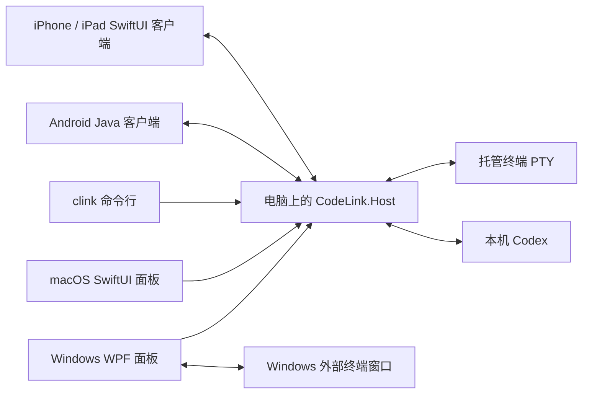

# 想读懂和继续开发 Code Link，从这里开始

Code Link 做的事情很直观。电脑负责运行终端或 Codex，手机和平板负责查看输出、发送输入、处理授权和接收提醒。任务实际运行在电脑上，移动端是这个任务的另一个操作入口。

先把项目当成三部分看，就容易找到代码。



这张图中的主机是逻辑上的同一角色。Windows 和 Mac 各自运行自己的 `CodeLink.Host`，不需要中央云服务器。

## 1. 项目用了哪些技术

| 部分 | 技术 | 主要用途 |
| --- | --- | --- |
| Windows 桌面 | C#、.NET 10、WPF | 窗口列表、设备配对、输出观察和托盘入口 |
| 共享主机与 CLI | C#、.NET 10 | 管理会话、认证、消息路由、终端和 Codex |
| Android | Java、Android 原生 View | 界面、USB / 蓝牙 / LAN 连接、前台服务与通知 |
| macOS / iOS | Swift、SwiftUI、Network、Security | Apple 原生界面、网络连接与钥匙串存储 |
| 终端画面 | xterm.js、WebView / WKWebView | 显示终端控制序列、接收键盘输入 |
| Windows 终端 | ConPTY、Windows API、UI Automation | 托管终端以及已有终端窗口的读取和输入 |
| Mac 终端 | 一个小型 C 程序、`forkpty` | 创建实际可交互的 zsh 终端 |
| 构建与发布 | PowerShell、Python、Bash、GitHub Actions | 构建、翻译校验、打包与合并检查 |
| 项目网站 | 静态 HTML、CSS、GitHub Pages | 介绍、下载入口、截图和搜索元数据 |

Android 没有使用 Flutter 或 React Native，也没有依赖 Gradle 来完成当前发布构建。脚本直接调用 Android SDK 的资源打包、Java 编译、DEX 转换和 APK 签名工具。Apple 工程由 XcodeGen 根据 `apple/project.yml` 生成。

## 2. 先看这几个目录

| 入口 | 阅读时重点看什么 |
| --- | --- |
| [desktop/CodeLink.Host/Program.cs](desktop/CodeLink.Host/Program.cs) | 电脑主机如何启动，生命周期如何结束 |
| [desktop/CodeLink.Core/Broker.cs](desktop/CodeLink.Core/Broker.cs) | 设备握手、会话状态推送、权限检查和动作分发 |
| [desktop/CodeLink.Core/Models.cs](desktop/CodeLink.Core/Models.cs) | 会话、设备、交互请求等数据模型 |
| [desktop/CodeLink.Core/Wire.cs](desktop/CodeLink.Core/Wire.cs) | 消息怎样从字节流还原为 JSON |
| [desktop/CodeLink.Desktop/MainWindow.xaml.cs](desktop/CodeLink.Desktop/MainWindow.xaml.cs) | Windows 界面怎样调用主机和读取外部窗口 |
| [android/app/src/main/java/com/codelink/app/LinkRuntime.java](android/app/src/main/java/com/codelink/app/LinkRuntime.java) | Android 界面、连接和提醒怎样协作 |
| [apple/Shared/LinkModel.swift](apple/Shared/LinkModel.swift) | Apple 界面状态、动作确认和重连逻辑 |
| [scripts](scripts) | 从源码到各平台发布包的完整入口 |

建议第一次阅读沿着一个动作走。先在手机发送一行文字，再找到客户端发送方法、主机收到动作的入口、实际写入终端的位置，最后看输出如何回到手机。比从头读完一个大文件更容易理解。

## 3. 一条输入是怎样到达终端的

手机上的发送按钮会构造一个 `action` 消息，里面包含动作 ID、会话 ID、动作类型和输入内容。它通过现有连接发送给主机。

主机先判断设备是否已经配对、会话是否共享给它、它是否持有输入控制权。检查通过后，才把输入交给对应的终端或 Codex。执行结果使用相同动作 ID 返回，客户端据此知道这次请求有没有得到确认。

这个确认只表示动作已被接收或处理，不等于终端任务已经成功完成。任务完成还要看后续状态。断线前没有收到确认时，也不能直接认定输入没执行，因此不能自动把同一条命令重新发送一遍。

消息格式采用 **4 字节大端长度 + UTF-8 JSON 正文**。可以把长度理解为包裹上的尺寸，收件方先读尺寸，再读完整内容。网络一次读取可能只有半条消息，也可能带回多条消息的一部分，所以不能把一次 `read` 当成一条完整消息。协议还限制消息大小，避免无限制分配内存。

局域网与 USB 反向端口连接使用 TLS，并核对配对邀请里的证书指纹。USB 在这里主要提供转发通道，不需要重新设计一套消息格式。Android 的经典蓝牙走 RFCOMM 和同一套消息帧、设备认证，不套用 TCP 的 TLS 实现。

## 4. 三种终端接入方式要分清

### Code Link 自己创建的终端

这类终端由主机掌握输入输出和进程生命周期。Windows 使用 ConPTY；Mac 由 [codelink-pty.c](apple/native/codelink-pty.c) 创建 PTY，再通过 [UnixTerminalProcess.cs](desktop/CodeLink.Core/UnixTerminalProcess.cs) 连接到 .NET 主机。

Mac 把 `forkpty` 放进独立小程序，是为了让创建子进程的工作离开已经运行多个线程的 .NET 进程。终端输出按 UTF-8 解码，输入和窗口尺寸通过明确的控制帧传递。

要注意，交互式 shell 一直开着时，一条命令打印完结果不代表整个 shell 已结束。需要可靠的进程完成提醒时，可以创建一条会自行退出的任务命令。

### 本机 Codex 会话

[CodexEngine.cs](desktop/CodeLink.Core/CodexEngine.cs) 负责启动并连接本机 Codex，通过结构化消息接收回合状态、授权和提问。它比“从屏幕上猜任务状态”提供了更明确的事件。

新增一种授权界面时，需要同时检查上游实际提供了哪些选项。客户端不能自行添加看起来合理、上游却不支持的权限范围。敏感输入也不应出现在普通日志里。

### Windows 已经打开的终端窗口

[CommandCatalog.cs](desktop/CodeLink.Core/CommandCatalog.cs) 查找窗口与进程，桌面面板读取可访问的窗口文本，[CodeLink.ConsoleBridge](desktop/CodeLink.ConsoleBridge/Program.cs) 在确认窗口身份后投递输入。

这种方式受 Windows 窗口可访问性、活动标签页和文本缓冲公开程度影响。它无法保证获得任意终端的完整配色和全部历史内容。切换标签页、窗口关闭或相同标题的多个终端，都需要明确处理。

[WindowActivity.cs](desktop/CodeLink.Core/WindowActivity.cs) 对已知屏幕特征进行保守识别。普通日志、没有新输出和未知状态都不能直接算作成功。

## 5. A / B 提醒为什么单独做成模块

界面负责展示，提醒模块负责判断事件。Android 的主要实现是 [ReminderState.java](android/app/src/main/java/com/codelink/app/ReminderState.java)，Apple 对应 [Reminders.swift](apple/Shared/Reminders.swift)。

- A 组关注单个任务，每个任务完成后产生提醒。
- B 组关注当前一批运行过的任务，等这一批满足完成条件后再提醒。
- 授权、提问、失败和中断有各自的处理方式，不能混入成功计数。
- 首次连接看到历史完成状态时，不应当作刚发生的新完成事件。
- 断线、会话被移除或状态暂时未知，都不能伪造完成。

提醒还有“是否未读”和“点通知后打开哪个会话”的问题。因此事件状态、通知显示和界面当前选中的任务应当分别管理。

Android 把连接放进前台服务，让 Activity 切到后台或重建后仍可接收状态。主要入口是 [LinkService.java](android/app/src/main/java/com/codelink/app/LinkService.java) 和 [LinkNotifications.java](android/app/src/main/java/com/codelink/app/LinkNotifications.java)。

iOS 的运行范围不同。当前实现进入后台后暂停连接，回到前台再重连，没有云推送服务。新增 iOS 功能时不能直接沿用 Android 常驻后台的假设。

## 6. 配对、安全与本地状态

配对邀请包含连接地址、短期配对码和主机证书指纹。首次配对后，设备获得自己的凭据，后续重连不必每次重新扫码。主机仍要逐次检查动作权限。

Windows 使用系统保护机制保存敏感数据；Mac 使用 Keychain 中的密钥保护主机秘密；Apple 移动端把设备凭据存入 Keychain。Android 连接和凭据逻辑见 [LinkConnection.java](android/app/src/main/java/com/codelink/app/LinkConnection.java)。

二次开发时，最容易出问题的是把调试方便当成正式行为。例如发布目录里混入自己的 `state`、配对文件或证书，打印整段配对信息，绕过证书指纹，或者重连后自动重放之前的写入动作。打包脚本采用白名单，并生成干净的运行配置，就是为了隔开应用文件与用户数据。

运行端收到消息后，应该使用稳定字段判断行为。比如授权失效使用 `auth_expired`，蓝牙内部使用 `Bluetooth`。不要根据“授权已失效”这类可翻译文案来决定协议行为。

## 7. 中文和英文包怎样构建

Windows 和 Android 的规范源码保留中文文案，[localization/en.json](localization/en.json) 保存英文对应项。[localize-sources.py](scripts/localize-sources.py) 只提取源码字符串和 XML 属性，把英文构建输入生成到 `.local/localized/en`，然后按正常方式编译。

这样不必维护两套业务代码。翻译缺失或 C# 插值表达式被改坏时，构建会停止。原始协议字段、状态机判断和用户终端内容不属于翻译对象。英文客户端只对已知的主机提示做匹配翻译，便于连接中文主机。

```powershell
python scripts/setup-tools.py
./scripts/build-desktop.ps1 -Language zh-CN
./scripts/build-desktop.ps1 -Language en
./scripts/build-android.ps1 -Language zh-CN
./scripts/build-android.ps1 -Language en
python scripts/package-release.py
```

Windows 需要 .NET SDK，Android 需要 JDK；完整环境要求见 [构建指南](docs/BUILDING.md)。修改界面文案后先运行 `python scripts/localize-sources.py extract` 查看待翻译项，再更新字典并执行 `check`。

Apple 界面当前使用英文，Mac 主机也使用生成后的英文源码。Mac 上运行 `bash scripts/build-apple.sh`，或使用 GitHub 的 Apple 工作流构建。Windows 本机不能直接生成经过 Xcode 编译的 Apple 应用。

包名最后的 `zh-CN` 和 `en` 表示应用语言。两种 Android 包使用相同应用 ID 和发布证书，可以覆盖切换语言并保留应用数据，不能同时作为两个独立应用安装。

## 8. 在此基础上开发，优先检查什么

| 你准备修改什么 | 需要一起检查的地方 |
| --- | --- |
| 新增主机动作 | Broker 权限、动作 ID、错误码、重复投递和客户端确认 |
| 新增状态或提醒 | Android 与 Apple 的提醒状态机、首次同步、断线、失败和中断 |
| 新增界面文案 | 英文字典、手机窄屏、按钮长度、通知与错误提示 |
| 修改终端输入 | Unicode、控制键、窗口身份、输入控制权，以及确认超时后的行为 |
| 修改连接与重连 | 保存的旧配置、证书指纹、设备撤销、超时和重复连接 |
| 修改持久化 | 旧版本数据读取、默认值、敏感数据保护与升级流程 |
| 修改发布 | 版本号、语言后缀、签名、校验文件、下载链接和安装指南 |

本地先跑与改动直接相关的检查，再通过 PR 进入主分支。仓库要求 Windows 和 Apple 检查通过，禁止强推和删除主分支。构建成功只能证明代码和部分行为通过检查，USB、蓝牙、厂商后台限制与 Apple 真机体验仍需在对应设备上验证。

第一次贡献可以从一个小改动开始，例如完善空状态提示、增加一条有明确输入和预期结果的状态识别样例，或补充一个手机布局问题。把复现步骤、修改原因和验证结果放进 PR，下一位维护者就能理解这个改动。

继续阅读：[项目当前实现](docs/implementation.zh-CN.md) · [Apple 平台范围](docs/APPLE.md) · [贡献指南](CONTRIBUTING.md) · [功能与仓库差距评估](docs/project-review.zh-CN.md)。
